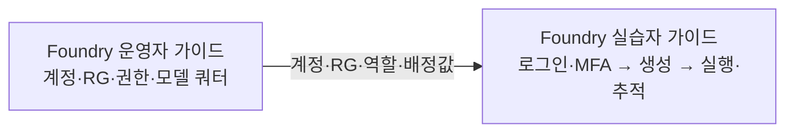

# Microsoft Foundry · Ignite 2026 실습 가이드

[English](README.md) · **한국어**

Microsoft Ignite 2026의 **Microsoft IQ와 Microsoft Foundry를 설명하는 한글 실습자·운영자 가이드**입니다. Microsoft IQ를 개요의 첫 항목으로 두고, 직접 실행한 범위는 **필수 실습 1~7(로그인 → 에이전트 → Foundry IQ·Web IQ)·선택 실습 8~16(Work IQ·Fabric IQ·하네스·개선 루프·Hosted agent·Manage·비용)**, 미검증 기능은 **소개 카드와 공식 문서**로 안내합니다. 실습 7(Web IQ, 포털 중심·CLI 없음)은 Azure Portal·Web IQ 포털·Foundry 포털에서 참가자 권한 계정으로 직접 실행했고, 실습 8(Work IQ)과 실습 9(Fabric IQ)는 2026.11.22에 Member 테스트 계정으로 직접 실행했습니다(실습 9는 Azure에서 F2 용량을 만들어 실행). **참조 가이드**(Work IQ·Fabric IQ 연결 방법, Microsoft Copilot 하네스·SDK 2.0 시작, GitHub Copilot 업데이트)는 공식 문서를 정리한 것이며 전부 실행하지는 않았습니다. Foundry IQ(이전 Azure AI Search)·Microsoft Copilot SDK(이전 GitHub Copilot SDK)·Microsoft Copilot 하네스(GitHub Copilot 하네스에서 발전)처럼 이름이 바뀐 것은 [이름 변경 한눈에 보기](index.html#ignite-renamed)에 정리했습니다. Work IQ·Fabric IQ와 **Microsoft Copilot SDK 2.0·Voice agents·비용 관리의 여러 층**을 설명하며, 발표 상태와 실제 검증 수준을 구분합니다.

> 운영자가 **계정·리소스 그룹(RG)·권한**을 준비하고, 참가자는 **본인 RG 안에서 Foundry·프로젝트·모델·관측성을 직접 만듭니다.** **실습자 가이드의 모든 화면·영상은 2026.11.18에 North Central US에서 참가자 권한 계정으로 새로 촬영했습니다.** **영문판**(`index.en.html`·`operator.en.html`)은 같은 구조의 번역본이며 **화면에 한글이 있던 화면·영상 구간은 영어 입력으로 2026.11.19(KST, UTC로는 11.18 저녁)에 다시 촬영**했습니다. PPT는 보류입니다.

Foundry 가이드는 [junwoojeong100/internal-guest-hands-on-guide](https://github.com/junwoojeong100/internal-guest-hands-on-guide) `main`의 `1524c3e`(2026.11.14)에서 가져와 Ignite 2026용으로 확장했습니다. 가져온 뒤의 변경은 Git 이력(첫 커밋 `8ebc58b`)에서 볼 수 있습니다.

## 실습 구성

| 실습 | 내용 | 구분 |
|---|---|---|
| 1 | 로그인·MFA와 내 계정·권한 확인 | 필수 |
| 2 | Foundry 리소스와 프로젝트 만들기 | 필수 |
| 3 | 모델 배포와 가드레일 확인 | 필수 |
| 4 | Prompt Agent 만들고 실행하기 | 필수 |
| 5 | Monitor·Traces로 확인하기 | 필수 |
| 6 | Foundry IQ로 에이전트에 지식 연결하기(운영자 사전 준비 필요) | 필수 |
| 7 | Web IQ로 에이전트에 최신 웹 정보 연결하기(포털만 사용·CLI 없음 · 직접 실행, 운영자 사전 준비 필요) | 필수 |
| 8 | Work IQ로 에이전트에 Microsoft 365 업무 맥락 연결하기(2026.11.22 Member 테스트 계정으로 직접 실행·화면 17장, 테넌트 관리자·운영자 사전 준비 필요) | 선택 |
| 9 | Fabric IQ로 에이전트에 Fabric 데이터 연결하기(2026.11.22 Azure·Fabric에서 직접 실행·화면 23장, Fabric 라이선스·용량·운영자 사전 준비 필요) | 선택 |
| 10 | 하네스 에이전트 만들고 실행·관찰하기 | 선택 |
| 11 | Insights로 개선할 문제 찾기 | 선택 |
| 12 | 평가자를 만들고 평가 실행하기 | 선택 |
| 13 | Optimize로 개선안 만들기 | 선택 |
| 14 | Hosted agent 호출하고 관찰하기(운영자가 사전 배포) | 선택 |
| 15 | Manage로 운영·비용·정책 보기 | 선택 |
| 16 | 비용 보기와 토큰 예산(Cost Control) 만들기 | 선택 |

## 소개 카드

직접 실행하지 않은 기능은 [`#ignite-learn-more`](index.html#ignite-learn-more)의 소개 카드로 안내합니다. Work IQ·Fabric IQ와 [Microsoft Copilot SDK 2.0](index.html#learn-copilot-sdk)·[Voice agents](index.html#learn-voice-agents)·[비용 관리](index.html#learn-cost-management) 등을 개념·구성별 상태·실습하지 않는 이유·공식 문서 링크·확인 수준 배지로 정리했으며, 문서만 확인한 내용을 검증된 실습으로 쓰지 않습니다. **Foundry IQ·Web IQ·Work IQ·Fabric IQ·Hosted agents는 실습과 연결된 개념 카드**이고, 실습 7(Web IQ)은 리소스·포털·도구 연결 단계와 Foundry 내장 Web search 도구 비교를 모두 직접 실행했다고 카드 배지에 적었습니다. 실습 8(Work IQ)과 실습 9(Fabric IQ)도 2026.11.22에 Member 테스트 계정으로 직접 실행했고, 실습의 표기와 Work IQ·Fabric IQ 카드가 서로를 가리키며 이를 밝힙니다. Microsoft Copilot 하네스·GitHub Copilot SDK·Microsoft Copilot SDK의 이름과 관계는 [이름 정리](index.html#ignite-harness-names)에 설명합니다. Toolboxes·Safety는 후보 점검을 하지 못했으며 기능이 없거나 참가자 권한에서 실패했다고 단정하지 않습니다. Work IQ·Fabric IQ의 연결 방법, Microsoft Copilot 하네스·SDK 2.0 시작, GitHub Copilot의 Ignite 2026 업데이트는 [참조 가이드](index.html#ignite-reference-guides)에 정리했습니다.

## 가이드

| 나는… | 가이드 | 소스 | 게시 주소 |
|---|---|---|---|
| **참가자(실습자)** | Foundry 실습자 가이드<br>로그인·MFA → 리소스 생성 → 실행·추적 | [`index.html`](index.html) · 영문 [`index.en.html`](index.en.html) | <https://junwoojeong100.github.io/microsoft-foundry-ignite-2026/> · 영문 <https://junwoojeong100.github.io/microsoft-foundry-ignite-2026/index.en.html> |
| **운영자(SE)** | Foundry 운영자 가이드<br>역할 → 스크립트/포털 → 필수 점검 → 인계·종료 | [`operator.html`](operator.html) · 영문 [`operator.en.html`](operator.en.html) | <https://junwoojeong100.github.io/microsoft-foundry-ignite-2026/operator.html> · 영문 <https://junwoojeong100.github.io/microsoft-foundry-ignite-2026/operator.en.html> |



두 가이드는 라이트/다크 테마와 **복사 버튼**을 지원합니다. 실습자 가이드는 화면 54장(실습 1~5)·159장(가드레일과 실습 6~16, Web IQ 21장·Work IQ 17장·Fabric IQ 23장 포함)과 5분 48초 요약 영상·53분 9초 전체 영상(둘 다 **실습 1~16 전체**, 전체 영상은 챕터 41개·자막)을 보고, 실습 6~9와 선택 실습 10~16에는 같은 녹화를 묶음별로 나눈 챕터·자막 영상이 각각 하나씩 있습니다(2026.11.22 녹화, 무음, 재생할 때만 내려받음). 영문판 영상은 5분 47초·53분 48초입니다. CDN·빌드 없이 정적 파일로 열리며, 로컬에서는 다음처럼 확인합니다.

```bash
python3 -m http.server 8000   # http://localhost:8000/index.html · /operator.html (영문: /index.en.html · /operator.en.html)
```

## 수정 위치

| 바꾸려는 것 | 고칠 곳 |
|---|---|
| 실습자 본문·문제 대응표·완료 기준 | `index.html` |
| 실습 제목·순서·필수/선택·선행·화면 근거·관련 카드 | `assets/labs-data.js`. 번호는 활성 배열 순서로 계산합니다. 재배치·번호·목차 렌더러는 `assets/labs.js`입니다. |
| 기본 Prompt Agent 절의 제목·설명 | `index.html` 아래쪽 인라인 스크립트의 `stages` |
| 단계별 화면·번호 표시·영상 시점·Instructions·녹화 예시값 | `assets/guide-data.js`. 화면 수가 바뀌면 `index.html`의 `data.shots.length !== 54`도 맞춥니다. |
| New Foundry 본문·소개 카드 | `index.html`의 `id="ignite-*"` 섹션·`id="learn-*"` 카드. 실습 목차는 `labs-data.js`가 정합니다. |
| New Foundry 화면·설명·확인 위치 | `assets/ignite/ignite-data.js`는 생성 파일입니다. 로컬 원본(Git 제외) `internal/tools/rec/`의 `assemble.py publish`가 촬영 결과와 `ignite_specs.json`·`ignite_overrides.json`으로 다시 생성합니다. 화면은 `assets/ignite/screenshots/ko/`(1600×900, 영문 UI + 한국어 입력), 그룹별 자리는 `index.html`의 `data-ignite-gallery="<그룹>"`입니다. 파일 이름·갤러리 순서를 맞추며 생성 JS는 직접 고치지 않습니다. |
| 화면 이미지·영상·자막 | `assets/screenshots/`, `assets/video/` |
| 실습 1~16 전체·요약 영상(재생기·챕터·자막) | 상단 요약 영상과 `index.html`의 `id="video"` 구역입니다. 챕터 41개·파트 3개·자막 큐는 `assets/guide-data.js`(영문 `guide-data.en.js`)의 `chapters`·`parts`·`videoCues`이고 자막 파일은 `assets/video/captions.ko.vtt`(영문 `captions.en.vtt`)입니다. 실습 1~5 챕터의 `videoSeconds`와 화면의 영상 버튼 시각은 전체 영상 맨 앞이 실습 1~5라서 그대로입니다. Git 제외 도구 `internal/tools/rec/all_labs.py`(`slates`·`full`·`plan`·`summary`)가 게시했던 영상 6개(`out-all/orig/`)를 이어 붙여 `full-walkthrough[.en].mp4`(3초 구분 화면 2장, x264 crf 33)와 2배속 요약 `summary-walkthrough[.en].mp4`(실습 라벨 막대)를 만들고, `publish_all_labs.py`가 `assets/video/`로 복사하며 `guide-data`를 원본에서 다시 씁니다. 요약 편집표는 `all_labs_plan.py`입니다. 생성 JS를 손으로 고치지 않습니다. |
| 실습 6~9·10~16 영상(재생기·챕터·자막) | `assets/lab-video.js`가 `data-lab-video` 구역(`video-iq`·`video-optional`)마다 재생기를 그리고 각 실습의 `data-lab-video-jump` 영상 버튼을 처리합니다. 구역 본문은 페이지에, 챕터·포스터·길이·자막 큐는 생성 파일 `assets/ignite/video-data.js`·`assets/ignite/video-data.en.js`에 있습니다. Git 제외 도구 `internal/tools/publish_lab_videos.py`가 `internal/tools/rec/out-v2/` 빌드 결과에서 `assets/video/iq-walkthrough[.en].mp4`·`optional-walkthrough[.en].mp4`·`captions-<묶음>.<ko\|en>.vtt`를 복사하고 데이터를 다시 만듭니다(`--stub`은 자리표시 영상을 만들고 `assets/video/.stub-files`에 적으며, 이 파일이 있으면 Pages 워크플로가 배포를 거부합니다). 생성 JS를 손으로 고치지 않습니다. |
| 운영자 본문(역할·준비 절차·점검·인계·종료) | `operator.html` |
| 참가자 계정·권한(역할) | `scripts/workshop_common.py`의 `ROLES`(기본 3개)·`IQ_ROLES`(Foundry IQ용 RG 범위 2개, 설정의 `foundryIq`가 `true`일 때)·`PROVIDERS`, 그리고 두 가이드의 역할 표 |
| Hosted agent 예제·배포 스크립트 | `assets/hosted-agent-sample/`(예제 소스)와 `scripts/deploy_hosted_agent.sh`(REST 배포·호출·삭제). 운영자 절차는 `operator.html#hosted-prep` |
| Foundry IQ 실습 문서 | `assets/foundry-iq-sample/*.md`(가상 문서 3개). 실습 6의 내려받기 링크와 테스트가 확인합니다. |
| 계정·RG 규모·이름·지역 | `config/workshop.example.json`, `scripts/provision_workshop.py`. 예제 설정은 `operator.html`의 JSON 예시·`location` 행과 같아야 하며 테스트가 확인합니다. |
| 로그인·MFA 이미지와 출처 | `assets/onboarding/`, `assets/onboarding/ATTRIBUTION.txt` |
| 기준일·검증 근거 | 두 가이드의 `기준일`과 `assets/verification.json`·`assets/guest-auth-verification.json`. 직접 검증하지 않은 기능으로 검증 범위를 넓혀 쓰지 않습니다. |
| 스타일·동작 | `assets/guide.css`, `theme.js`, `navigation.js`, `copy.js`, `ignite-part2.js`(New Foundry 갤러리, 확대 창은 모든 화면이 공유) |
| 영문판 | `index.en.html`·`operator.en.html`은 한국어판과 같은 구조(id·링크·표 행 수·갤러리 그룹)의 번역본이고 테스트가 구조 동등성과 한글 0건을 확인합니다. 데이터는 `assets/guide-data.en.js`·`labs-data.en.js`·`ignite/ignite-data.en.js`·`ignite/video-data.en.js`, 공통 화면 문구는 `assets/i18n.js`(`<html lang>`으로 언어 선택), 영문 샘플 문서는 `assets/foundry-iq-sample/en/`, 영상·자막은 `assets/video/*.en.mp4`·`captions.en.vtt`·`captions-*.en.vtt`입니다. **영어 입력으로 다시 찍은 화면만** `assets/screenshots/en/`(본문 54장 중 26장)·`assets/ignite/screenshots/en/`(New Foundry 98장 중 29장과 자리표시 1장)에 있고 나머지는 한국어판 화면 파일을 그대로 가리킵니다. 영어 촬영으로 만든 개체의 이름에는 `-en`을 붙입니다(예: `workshop-assistant-en`). |

가이드의 모든 `<pre>`에는 복사 버튼 이름으로 쓰는 `aria-label`이 필요합니다. 이 규칙과 링크·앵커는 아래 [테스트](#테스트)가 확인합니다.

## 운영자 빠른 시작 · Azure 계정·RG·권한 일괄 준비

**Azure Cloud Shell Bash(영구 저장소), Linux/macOS 또는 WSL · Python 3.11+ · Azure CLI**가 필요하며 추가 Python 패키지는 없습니다. 소규모·수동 준비는 [B · 포털 절차](https://junwoojeong100.github.io/microsoft-foundry-ignite-2026/operator.html#portal)를 따르고, 같은 환경에 A/B를 중복 실행하지 않습니다.

```bash
git clone https://github.com/junwoojeong100/microsoft-foundry-ignite-2026.git
cd microsoft-foundry-ignite-2026
cp config/workshop.example.json config/workshop.local.json
# local.json의 tenantId·subscriptionId·고유 workshopId·지역·계정 수를 확인/수정한 뒤 로그인합니다.
az login --tenant "REPLACE_WITH_TENANT_ID"

# 1) 읽기 전용 계획 (기본값: 계정·RG·역할·암호 파일을 만들지 않습니다)
python3 scripts/provision_workshop.py --config config/workshop.local.json

# 2) 검토한 계획을 실제 적용
python3 scripts/provision_workshop.py --config config/workshop.local.json --apply

# 3) 실제 Graph/ARM 상태를 다시 읽어 독립 검증 (실패 시 종료 코드 1)
python3 scripts/verify_workshop.py --config config/workshop.local.json
```

예제 설정(`participantCount=75`, `seTestAccountCount=5`, `nameFormat="user-se"`, `foundryIq=true`)은 **고객 `user01`~`user70` + SE 테스트 `se01`~`se05`** 계정, RG `rg-user01`~`rg-user70`·`rg-se01`~`rg-se05`, 직접 RBAC **375개**(계정당 Contributor·Foundry User·Search Service Contributor·Search Index Data Contributor는 본인 RG, Cognitive Services Usages Reader는 구독; `foundryIq=false`면 225개)를 만듭니다. Foundry IQ(실습 6)의 검색 서비스와 관리 ID 역할은 스크립트가 아니라 [운영자 가이드 필수 실습 6·7 준비](https://junwoojeong100.github.io/microsoft-foundry-ignite-2026/operator.html#iq-prep)의 명령으로 준비합니다. 이름 충돌·재실행·복구·비공개 파일 취급은 [운영자 가이드 A](https://junwoojeong100.github.io/microsoft-foundry-ignite-2026/operator.html#automation)를 따르세요.

## 꼭 지킬 기준

| 주제 | 기준 |
|---|---|
| 참가자 권한 | **본인 RG의 Contributor·Foundry User + 구독의 Cognitive Services Usages Reader**(Foundry IQ 실습 6을 운영하면 본인 RG의 Search Service Contributor·Search Index Data Contributor를 더함). Entra 관리자 역할은 없습니다. 운영자 Owner 권한은 참가자에게 전달되지 않습니다. |
| 첫 로그인 | 초기 암호 그대로 로그인하며 변경을 강제하지 않습니다(`forceChangePasswordNextSignIn=false`). **MFA 등록·인증은 본인이 완료**하고 MFA·조건부 액세스는 해제하지 않습니다. |
| 인계 전 필수 | **실제 교육망에서 MFA 미등록 테스트 Guest 2개의 첫 로그인·MFA 등록·재로그인**을 확인합니다. 스크립트 PASS나 운영자 계정 성공으로 대신하지 않습니다. |
| 모델·TPM | 일반 실습은 **`gpt-6.1-terra`를 개인별 TPM으로 배분**합니다((70 + 5) × 10,000 = 750,000 TPM은 계산 예시). Optimizer 등 모델 고정 설정은 지정 모델을 유지합니다. |
| 리전 | 참가자 리전은 **North Central US**(`northcentralus`)로 통일합니다(공식 하네스 지원 리전, 2026.11.17 문서 기준). 포털의 Region 기본값은 East US이므로 목록에서 직접 고릅니다. 예제 설정·운영자 JSON·실습자 안내가 어긋나면 테스트가 실패합니다. |
| 관측성 | 본인 RG의 Application Insights를 사용합니다. Foundry 리소스를 만들 때 Application insights를 함께 만들면 프로젝트에 자동 연결되고, Traces에 연결 안내가 보이면 Agent → Traces → **Connect → Create new resource**(대체 경로, 새 Application Insights와 `DefaultWorkspace-*`가 같은 RG에 생성)를 따릅니다. |
| 필수 실습 6·7 준비 | **Foundry IQ(실습 6)**는 RG마다 serverless Azure AI Search 1개, 검색 서비스 관리 ID의 Cognitive Services User, 프로젝트 관리 ID의 Search Index Data Reader(프로젝트 생성 뒤)가 필요하고 임베딩 모델 쿼터(Standard ada-002는 이번 구독·지역에서 350K TPM)를 확인합니다. **Web IQ(실습 7)**는 유료 Azure 구독·구독에 `Microsoft.WebIQ` 공급자 등록·약관과 과금 승인이 필요합니다. 단계(리소스·Web IQ 포털·Foundry 도구 연결)는 구독 1곳에서 참가자 계정으로 직접 실행해 확인했으니 사용할 구독에서 리허설하세요. 참가자는 포털에서 리소스를 삭제할 수 없어 운영자가 지우며, 리소스를 만들 수 없는 참가자는 실습 7-5의 내장 Web search로 대신합니다. 상세는 [운영자 가이드 `#iq-prep`](operator.html#iq-prep)를 따릅니다. |
| 선택 실습 준비 | 하네스·평가·Optimize·Manage(실습 10~15)는 개인 10,000 TPM으로 부족하고, 평가자 만들기의 Resolve(프로젝트 관리 ID의 Monitoring Reader)는 참가자가 누르면 권한 오류가 나므로 운영자가 할당합니다. Hosted agent(실습 14)는 운영자가 프로젝트마다 소스 ZIP을 배포합니다. Work IQ(실습 8, 2026.11.22 직접 실행)는 전역 관리자의 1회 테넌트 설정, 라이선스 결정, 질문하는 사용자 사서함에 시험용 메일·일정 넣기, 프로젝트별 Work IQ MCP 연결 만들기가 필요하며 [운영자 가이드 `#work-iq-prep`](operator.html#work-iq-prep)를 따릅니다. Fabric IQ(실습 9, 2026.11.22 직접 실행)는 Fabric 라이선스, 유료 F2 이상 용량, Fabric 테넌트 설정, 게시된 Fabric 항목이 필요하고 프로젝트별 Fabric IQ (OneLake Catalog) 도구(`fabric_iq_preview`) 연결을 만들어야 하며(실습 뒤 용량 일시 중지·삭제) [운영자 가이드 `#fabric-iq-prep`](operator.html#fabric-iq-prep)를 따릅니다. 상세는 [운영자 가이드 `#part2-prep`](operator.html#part2-prep)를 따릅니다. |
| 비공개 파일 | `.workshop-runs/<workshopId>/`(초기 암호 포함)는 Git·Pages에서 제외하고 승인된 비공개 저장소에 백업합니다. 참가자 암호는 별도 경로로 개별 전달합니다. |

## 검증 현황

- **확인한 것:** 2026.11.18 North Central US에서 참가자 역할 3개만 가진 새 Internal Guest 계정 1개로 초기 암호 로그인·TOTP MFA 등록·재로그인과 실습 1~16 중 실습 8·9(Work IQ·Fabric IQ, 이 계정이 아니라 Member 테스트 계정으로 따로 실행)를 뺀 모든 실습을 처음부터 끝까지 실행하고 화면을 새로 촬영했습니다(요약·전체 영상은 실습 1~5의 2026.11.18 녹화에 실습 6~9와 10~16의 2026.11.22 녹화를 이어 붙여 2026.11.23에 실습 1~16 전체로 다시 편집한 것이고, 실습 6~16 녹화는 단계별 화면과 따로 다시 실행해 찍어 결과가 화면과 다를 수 있습니다). 실습 6(Foundry IQ)은 운영자가 검색 서비스·역할을, 실습 14(Hosted agent)은 운영자가 에이전트를 미리 준비한 상태였습니다. 환경은 기존 RG의 리소스를 모두 지운 뒤 새로 만들었습니다(`gpt-6.1-terra` 10,000 TPM으로 필수 실습 1~5, 이후 실습은 운영자가 100,000 TPM으로 상향). Manage의 Cost·Compliance·Gateways는 생성·할당 없이 화면만 확인했습니다. 화면·영상은 계정·구독·테넌트 값을 가렸고 OCR로 개인 정보 문자열이 없는지 점검했습니다. [읽기 전용 검증 JSON](assets/verification.json)(ID는 0으로 대체)과 2026.11.08 로그인 검증 [JSON](assets/guest-auth-verification.json)을 제공합니다. **영문판**은 한글이 있던 화면·영상 구간을 같은 프로젝트·같은 참가자 계정으로 영어 입력을 써서 다시 촬영했고(`-en` 이름의 새 개체를 만들었으며 삭제는 없었습니다), 나머지 화면은 원래 촬영본을 재사용합니다. 실습 12의 Setup incomplete / Resolve 경고 화면은 Monitoring Reader가 이미 부여돼 있어 재현하지 못해, 영문판에는 "English screenshot in preparation" 자리표시 화면을 두고 단계 설명으로 경고를 안내합니다. **실습 7(Web IQ)**은 2026.11.21에 같은 참가자 계정으로 Azure Portal·Web IQ 포털·Foundry 포털에서 다시 실행했습니다. 운영자가 `Microsoft.WebIQ` 공급자를 등록한 뒤 참가자가 Web IQ 리소스를 만들고, Playground에서 HTTP 200을 받고, Foundry Catalog의 Web IQ 도구를 연결해 질문한 뒤 Traces에서 `execute_tool mcp_WebIQ.web`을 확인했습니다. 화면 21장을 촬영했고(영문판은 그중 9장을 영어 입력으로 다시 촬영) 참가자는 포털에서 리소스를 삭제하지 못해 운영자가 CLI로 삭제했습니다. **실습 8·9(Work IQ·Fabric IQ)**는 2026.11.22에 New Foundry와 Fabric 포털에서 실행했습니다. Microsoft 365 E7 라이선스와 참가자 역할 3개를 준 Member 테스트 계정을 만들고, Work IQ 서비스 주체·앱 등록·동의·시험용 메일·일정을 Microsoft Graph로 준비했으며, F2 Fabric 용량·작업 영역·샘플 레이크하우스(표 28개)·데이터 에이전트를 만들었습니다. 실습 8은 연결·첫 로그인·동의·승인·질문 3개·권한 경계(운영자 사서함에만 있는 메일)·Traces(화면 17장, 영문판은 그중 11장을 영어 입력으로 다시 촬영)를, 실습 9는 네 단계로 Fabric 포털에서 데이터 에이전트 만들기·게시·공유, Fabric IQ (OneLake Catalog) 도구로 연결 만들기, 에이전트에 도구 연결, 질문 3개·권한 없는 계정의 무응답과 Failed 트레이스·Traces(화면 23장, 영문판은 그중 9장을 영어 입력으로 다시 촬영)를 다룹니다. 주요 발견: 라이선스·사서함이 없는 Internal Guest 참가자 계정은 Work IQ 결과가 비어 있고, Work IQ는 시간을 UTC로 다루며, OneLake Catalog는 기본 필터(Semantic model)를 해제해야 데이터 에이전트가 보이고, Fabric 권한이 없는 계정은 답 없이 `tool_user_error`로 Failed 트레이스가 남으며, 같은 Fabric 질문도 실행마다 숫자가 다를 수 있습니다.
- **아직 확인하지 않은 것:** **실습 8(Work IQ)의 Entra 포털 화면(관리자 설정은 Graph로 실행), Copilot Credits 과금을 켠 테넌트, SharePoint 문서 권한 시험, 라이선스를 가진 외부(Guest) 사용자**, **실습 9(Fabric IQ)의 온톨로지·Power BI 시맨틱 모델·사용자 지정 OAuth 앱·Fabric 라이선스 종류별 차이·데이터 에이전트나 레이크하우스 한쪽에만 권한을 준 경우·도구 호출 승인을 켰을 때의 동작**, **참조 가이드(Work IQ·Fabric IQ 연결, Copilot SDK 시작, GitHub Copilot 업데이트) 중 실습 8·9가 실행하지 않은 부분**, **여러 참가자의 동시 사용과 70명 규모**(Foundry IQ의 serverless Search 서비스 수 한도·임베딩 쿼터, Hosted agent 프로젝트별 일괄 배포, 참가자마다 자기 Web IQ AppID를 받는지), **Cost Control의 Send alert·Block usage·달러 예산**, **AI Gateway 생성·Publish·채널 연결·Optimize 후보 승격·하네스 에이전트의 Optimize 제출·Azure Policy 할당**(2026.11.17에 별도 환경에서만 확인), 다른 구독 유형의 Web IQ(이번에는 내부 구독 1곳), Custom MCP 연결 경로, Web IQ의 Entra ID 인증·Scopes·BYOL·Commerce·Auto, Cost analysis의 Web IQ 호출 비용, 스크립트가 새로 띄운 브라우저로 보낸 질문의 트레이스가 도착하지 않은 원인, SharePoint 지식 소스·지식 그래프, 운영 구독의 North Central US `gpt-6.1-terra` 쿼터, 10,000 TPM에서의 하네스 재현(2026.11.17 시험은 실패, 이번 재촬영은 100,000 TPM), 비용 데이터가 쌓인 뒤의 Cost 화면(Cost Management Reader 필요 여부), 고객 교육망, Microsoft Authenticator 푸시(촬영 계정은 TOTP로 등록). 개최 전 운영자 가이드의 필수 점검으로 확인하세요.
- **공식 자료:** 기능 이름·상태(Preview/GA)는 2026.11.18에 Ignite 2026 [Book of News](https://news.microsoft.com/events/ignite/2026/book-of-news/)와 공식 블로그·Learn으로 대조했으며(표: [`#ignite-official-check`](index.html#ignite-official-check)), 발표된 모든 변경이 포털에 반영됐다고 단정하지 않습니다. 웹 문서 점검이 Foundry IQ·SDK·Voice 등의 기능 실행 검증을 뜻하지는 않습니다.

## 테스트

Azure에 접속하지 않고 스크립트(가짜 API), 링크·앵커, 화면·영상 파일, 실습 1~16 전체·요약 영상(챕터 41개·파트·자막·길이·크기·MP4에 내장한 챕터·요약 라벨이 16개 실습 모두를 말하는지), 실습 6~16 영상 데이터(가이드 단계를 가리키는 챕터·자막·길이·크기), New Foundry 화면 데이터(1600×900·확인 위치), 실습 배정·선행·교차 참조·목차 순서, 소개 카드, 예제 설정과 운영자 JSON의 일치, 전환 메뉴·Pages 범위, **한/영 페이지의 구조 동등성·언어 전환 링크·영문 파일의 한글 0건·영문 영상 길이**를 검사합니다.

```bash
python3 -m unittest discover -s tests -v
```

## 배포

`main`에 푸시하면 [GitHub Actions 워크플로](.github/workflows/pages.yml)가 위 테스트를 통과한 뒤 HTML·`assets/`(화면·영상)·공개 스크립트·예제 설정만 빌드해 GitHub Pages에 자동 배포합니다. Pages의 배포 원본은 **GitHub Actions**이고 진행 상태는 [Actions](https://github.com/junwoojeong100/microsoft-foundry-ignite-2026/actions/workflows/pages.yml)에서 확인합니다. CI는 Azure 계정·RG·역할을 만들지 않습니다. 화면 출처·재사용 조건은 [ATTRIBUTION](assets/onboarding/ATTRIBUTION.txt)에 있습니다.

- **주소를 바꿀 때:** `operator.html`의 clone·Pages·저장소 주소(인계 템플릿 포함)와 이 README, `tests/test_guides.py`의 `SITE_URL`을 함께 바꿉니다.
- **영상 크기:** `assets/video/*.mp4`는 GitHub 권장 한도 50 MiB·차단 한도 100 MiB 이내로 유지합니다(현재 `full-walkthrough.mp4` 약 46.9 MiB, `summary-walkthrough.mp4` 약 18.2 MiB, 영문판 `full-walkthrough.en.mp4` 약 47.6 MiB, `summary-walkthrough.en.mp4` 약 19.0 MiB). 새 영상으로 교체할 때 크기를 확인하세요. 실습 1~16 전체 영상 2개(`full-walkthrough*.mp4`)와 실습 6~16 영상 4개(`iq-walkthrough*.mp4`·`optional-walkthrough*.mp4`)는 각각 50 MiB 미만이어야 하며 테스트가 확인합니다.
- **예시 식별자:** `assets/guide-data.js`·`assets/verification.json`은 테넌트·구독·개체 ID를 0으로 채우고 계정 표시는 `user@contoso.com` 등으로 바꾼 값입니다(리소스·프로젝트 이름은 촬영 예시). `config/workshop.example.json`과 `operator.html`의 JSON 예시도 두 ID를 0으로 채운 자리표시자이며, 실제 값은 Git에서 제외한 `config/workshop.local.json`에 넣습니다.
