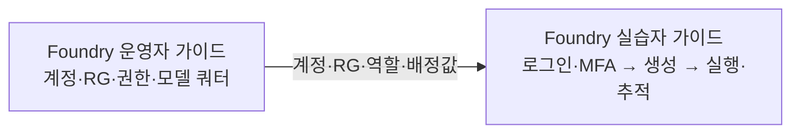

# Microsoft Foundry · Ignite 2026 실습 가이드

Microsoft Ignite 2026에서 발표되는 **Microsoft Foundry 신규 기능을 소개하고 직접 실습**하는 가이드를 만들기 위한 리포입니다. 기존 Foundry 워크샵의 **실습자·운영자 가이드를 그대로 가져온 기반(baseline)** 위에, 실습자 가이드 끝에 **PART 2 · 2026.11.17 새 Foundry 포털 화면**을 추가했습니다. 기존 PART 1 본문과 운영자 가이드는 **리전 안내를 North Central US로 통일한 것, 2026.11.17 North Central US 재현에서 다르게 보인 점을 덧붙인 메모, 운영자 가이드의 'PART 2 준비' 섹션 외에는** 바꾸지 않았으며, 영문판·동영상·슬라이드는 아직 없습니다.

> 운영자가 **계정·리소스 그룹(RG)·권한**을 준비하고, 참가자는 **본인 RG 안에서 Foundry·프로젝트·모델·관측성을 직접 만듭니다.** 이 틀을 유지한 채 본문을 Ignite 2026 신규 기능으로 바꿔 나갑니다.

## 현재 상태 · 가져온 기반

| 항목 | 내용 |
|---|---|
| 원본 | [junwoojeong100/internal-guest-hands-on-guide](https://github.com/junwoojeong100/internal-guest-hands-on-guide) `main`의 `1524c3e`(2026.11.14). [이후 변경 보기](https://github.com/junwoojeong100/internal-guest-hands-on-guide/compare/1524c3e...main) |
| 가져온 것 | Foundry 실습자·운영자 가이드, 공통 자산(CSS·JS·화면 63장·영상 2개·로그인/MFA 이미지·검증 JSON), 운영자 자동화 스크립트와 설정 예제, 오프라인 테스트, Pages 워크플로 |
| 가져오지 않은 것 | GitHub Copilot 실습자·운영자 가이드, Codespaces·Copilot CLI 가이드, 고객 안내 EDM, 그 가이드들의 이미지 |
| 가져오며 바꾼 것 | 가이드 전환 메뉴를 Foundry 2종으로 축소 · GitHub 가이드로 가는 링크·안내·인계 템플릿 줄 제거 · 저장소·Pages 주소를 이 리포로 변경 · 테스트와 워크플로를 2종 기준으로 조정하고 화면·영상 파일 점검 추가 · `ATTRIBUTION.txt`에서 가져오지 않은 이미지 항목 제거 · `.gitignore`에 `.playwright-mcp/` 추가 · README 재작성 |
| 그대로인 것 | 본문, 화면·영상(2026.11.05 녹화, East US 2·GPT-5 mini), 검증 JSON, 스크립트. 다만 참가자가 입력·선택하는 리전 안내는 North Central US로 바꿨고(아래 PART 2 표의 '리전' 행), 2026.11.17 North Central US 재현에서 화면이 달랐던 점(Application insights 자동 생성·연결, 새 에이전트의 기본 모델 model-router, 메뉴 이름)은 해당 단계 아래에 메모로 덧붙였습니다. 화면·영상 자체는 Ignite 신규 기능 기준으로 다시 확인한 내용이 아닙니다. 신규 화면은 아래 PART 2에만 있습니다. |

첫 커밋이 원본 그대로이므로 `git diff <첫 커밋> HEAD`로 가져오며 바꾼 내용을 모두 볼 수 있습니다.

## PART 2 · 새 Foundry 포털 화면 (2026.11.17)

| 항목 | 내용 |
|---|---|
| 위치 | 실습자 가이드 `index.html`의 `#ignite-overview`~`#ignite-finish` 9개 섹션(사이드바 `PART 2`·`N1`~`N8`). 개요 맨 위에 흐름도·단계표(`#ignite-at-a-glance`)와 용어 풀이(`#ignite-glossary`)가 있습니다. 기존 내용은 삭제·수정하지 않고 **추가만** 했습니다(히어로 버튼 1개, `#finish`의 다음 단계 링크 1줄, `#model-quota`의 TPM 안내 1개 포함). |
| 흐름 | New Foundry 시작 → 가드레일·`gpt-6.1-terra` 배포 → Microsoft Copilot 하네스 에이전트 생성·도구 제한·실행 → Traces·Monitor → Insights·커스텀 루브릭 평가자·평가 실행·Optimize → Manage의 Fleet·Cost·Compliance·Gateways |
| 화면 | `assets/ignite/screenshots/ko/` 51장(1600×900, 영문 UI + 한국어 입력). 계정·구독·테넌트 값은 가렸고 OCR로 개인 정보 문자열이 없는지 검사했습니다. **동영상은 아직 없습니다.** |
| 데이터·코드 | `assets/ignite/ignite-data.js`(화면별 설명과 확인 위치 좌표), `assets/ignite-part2.js`(갤러리·사이드바 렌더링). 확대 창은 PART 1과 공유합니다. |
| 직접 실행 | **① 샌드박스 프로젝트(소유자 권한):** 가드레일 목록, `gpt-6.1-terra` 배포(Global Standard·100,000 TPM), 하네스 에이전트 생성·도구 제한·저장(Version 4)·실행, Insights 스캔, 커스텀 루브릭 평가자, 합성 질문 15개 평가 실행(12행 채점·3행 rate limit 오류). **② 참가자 권한 재현 프로젝트(별도 구독, North Central US, 계정 1개에 RG Contributor + Foundry User + 구독 Usages Reader만 부여):** PART 1을 처음부터(Foundry 리소스·프로젝트 생성 → `gpt-6.1-terra` 10,000 TPM 배포 → Prompt Agent → Traces), 하네스 에이전트 생성·실행(10,000 TPM은 실패, 30,000 TPM은 단건 통과), Manage의 Fleet·Cost·Operations·Compliance·Quota·Gateways 열기, Insights 스캔, 커스텀 루브릭 평가자와 평가(15행 모두 통과), 하네스를 쓰지 않는 Prompt Agent의 Optimize 실행(후보 승격은 안 함), Azure Policy Audit 할당·해제 |
| 화면만 확인 | 샌드박스의 Manage(Fleet·Operations·Cost·Compliance·Gateways), Routines·Workflows, 하네스 에이전트의 Optimize 탭·마법사(제출하지 않음) |
| 하지 않음 | AI Gateway 생성, Publish·채널 연결, Optimize 후보 승격, 하네스 에이전트의 Optimize 제출, 운영 구독의 North Central US `gpt-6.1-terra` 쿼터 확인, 여러 참가자의 동시 실행·부하 |
| 리전 | PART 1·PART 2 모두 **North Central US**(`northcentralus`)로 통일했습니다. 공식 하네스 지원 리전 22곳에 포함됩니다(2026.11.17 문서 기준). 예제 설정(`config/workshop.example.json`), `operator.html`의 JSON 예시·표, 실습자 가이드의 리전 안내를 맞췄고 값이 어긋나면 테스트가 실패합니다. PART 1 화면·영상은 East US 2에서 녹화해 바꿀 수 없으므로 '녹화 예시: East US 2'로 남기고 '화면은 녹화 당시 East US 2'라고 덧붙였습니다. 참가자 권한 계정의 Create a Foundry resource 화면 Region 목록(39개)에 North Central US가 있음을 직접 확인했습니다. |
| 공식 자료 대조 | 2026.11.18에 **Ignite 2026 Book of News(가장 중요한 발표인 Microsoft IQ와 Foundry 항목)**와 그 상세인 Foundry 블로그·Learn 문서로 PART 2 개요의 '발표·공식 자료와 맞춰 본 결과' 표를 다시 정리했습니다(출처: [Book of News](https://news.microsoft.com/events/ignite/2026/book-of-news/), [Microsoft IQ 블로그](https://azure.microsoft.com/en-us/blog/introducing-the-new-microsoft-iq-putting-your-organizations-intelligence-to-work-in-every-agent/), [Continuous improvement comes to Microsoft Foundry](https://azure.microsoft.com/en-us/blog/continuous-improvement-comes-to-microsoft-foundry/), [Foundry 모델 블로그](https://techcommunity.microsoft.com/blog/azure-ai-foundry-blog/from-model-choice-to-your-durable-advantage-build-ai-that-keeps-improving/4573609)). **Microsoft IQ는 GA**로 발표됐습니다(새 SKU·구독 없이 이미 쓰는 제품 위에 구성, 거버넌스는 Microsoft Agent 365와 함께). 엔터프라이즈 컨텍스트 관리(Work IQ·Fabric IQ·Foundry IQ·Web IQ, business plugins)와 Foundry의 지속 개선을 묶은 플랫폼이며, 이 가이드는 그중 **Foundry의 지속 개선**만 직접 따라 하고 Foundry IQ는 쓰지 않으며 나머지는 범위 밖입니다(PART 2 개요의 `#ignite-microsoft-iq`). 발표 기준으로 **Insights·Agent optimizer·멀티턴 평가는 GA**, 트레이스 주석·golden dataset·루브릭 평가자의 안전 지원·스킬/비용 최적화·Programmed Training·Cost는 Preview이고 Microsoft Copilot 하네스는 Foundry 블로그가 Preview로 소개합니다. 블로그는 지원 프로젝트에서 자동 모델 선택(model router)이 기본이라고 설명하며(2026.11.17 재현에서 새 Prompt Agent의 기본 모델이 model-router였던 것과 같은 설명), 새 Foundry 프로젝트마다 Foundry IQ 리소스(Preview)가 생긴다는 발표는 이 가이드의 화면에서 확인하지 못했습니다. Learn 문서는 2026.11.18에 Insights·Agent optimizer·평가자·합성 데이터셋 제목의 preview 표기를 뺐고 거버넌스 문서가 Operate 대신 Manage로 안내합니다. **포털의 평가 기반 최적화는 하네스를 쓰지 않는 Prompt Agent만 지원한다는 문서 안내는 그대로**라 5-4 경고를 유지했고, 재현에서 Prompt Agent의 Optimize는 성공했으며 하네스 에이전트는 마법사만 열고 제출하지 않았습니다. **발표 뒤 포털 화면은 다시 열어 보지 않았습니다**(화면은 키노트 전 캡처). |
| 운영자에게 알릴 점 | 운영자 가이드의 [`#part2-prep`](operator.html#part2-prep) 섹션에 리전·하네스용 TPM·필요 역할·Azure Policy·Optimize·비용·정리를 '공식 문서 기준 / 직접 실행 / 화면만 확인 / 확인하지 못함'으로 나누어 추가했습니다. 재현에서 나온 사전 결정 3가지: **① 평가자 만들기의 Resolve(프로젝트 MI의 Monitoring Reader)는 참가자가 누르면 권한 오류**가 나서 운영자가 할당해야 합니다(명령 예는 `#managed-identity`). **② 10,000 TPM 배포에서는 하네스 질문이 실패**했습니다(30,000 TPM은 천천히 보낼 때만 통과). **③ Compliance의 Asset 탭에 Foundry User 권한 안내**가 떴고 원인은 확인하지 못했습니다. 참가자 필수 역할 3개 표는 바꾸지 않았습니다(3개 역할만으로 화면이 열렸고 Cost 값 표시에 Cost Management Reader가 필요한지만 미확인). |

화면 기준일은 2026.11.17(키노트 전)이고 기능 이름·상태(Preview/GA)는 2026.11.18에 Ignite 2026 Book of News로 다시 대조했습니다. 발표 뒤 포털 화면을 다시 확인하는 일은 남아 있습니다.

## 가이드

| 나는… | 가이드 | 소스 | 게시 주소 (Pages 배포 후) |
|---|---|---|---|
| **참가자(실습자)** | Foundry 실습자 가이드<br>로그인·MFA → 리소스 생성 → 실행·추적 | [`index.html`](index.html) | <https://junwoojeong100.github.io/microsoft-foundry-ignite-2026/> |
| **운영자(SE)** | Foundry 운영자 가이드<br>역할 → 스크립트/포털 → 필수 점검 → 인계·종료 | [`operator.html`](operator.html) | <https://junwoojeong100.github.io/microsoft-foundry-ignite-2026/operator.html> |



두 가이드는 라이트/다크 테마를 지원하고, 명령·JSON·인계 템플릿에는 **복사 버튼**이 있습니다. 실습자 가이드에는 63장의 실제 화면, 3분 요약 영상, 51분 전체 영상이 포함되며 끝에 PART 2(새 포털 화면 51장)가 이어집니다. CDN·빌드 없이 정적 파일로 열리며, 로컬에서는 다음처럼 확인합니다.

```bash
python3 -m http.server 8000   # http://localhost:8000/index.html · /operator.html
```

## Ignite 2026 가이드로 바꿀 때 고칠 곳

| 바꾸려는 것 | 고칠 곳 |
|---|---|
| 실습자 본문·문제 대응표·완료 기준 | `index.html` |
| 실습 단계(제목·설명·순서) | `index.html` 아래쪽 인라인 스크립트의 `stages` |
| 단계별 화면·번호 표시·영상 시점·Instructions·녹화 예시값 | `assets/guide-data.js`. 화면 수가 바뀌면 `index.html`의 `data.shots.length !== 63`도 맞춥니다. |
| PART 2(새 포털 화면) 본문 | `index.html`의 `id="ignite-*"` 섹션. 사이드바 이름은 섹션의 `data-ignite-nav`·`data-ignite-title`로 정합니다. |
| PART 2 화면·설명·확인 위치 | `assets/ignite/ignite-data.js`와 `assets/ignite/screenshots/ko/`. 화면 그룹을 만들면 `index.html`에 `data-ignite-gallery="<그룹>"` 자리표시자를 하나씩 둡니다. 화면 번호는 파일 이름의 `NN`과 갤러리 순서가 같아야 합니다. |
| 화면 이미지·영상·자막 | `assets/screenshots/`, `assets/video/`. `assets/capture-manifest.json`은 같은 구조의 캡처 기록(다운로드용)이므로 함께 갱신합니다. |
| 운영자 본문(역할·준비 절차·점검·인계·종료) | `operator.html` |
| 참가자 Azure 역할·리소스 공급자(RP) 등록 목록 | `scripts/workshop_common.py`의 `ROLES`·`PROVIDERS`, 그리고 두 가이드의 역할 표 |
| 계정·RG 규모·이름·지역 | `config/workshop.example.json`, `scripts/provision_workshop.py`. 예제 설정은 `operator.html`의 JSON 예시·`location` 행과 같아야 하며 테스트가 확인합니다. |
| 로그인·MFA 이미지와 출처 | `assets/onboarding/`, `assets/onboarding/ATTRIBUTION.txt` |
| 기준일·검증 근거 | 두 가이드의 `기준일`과 `assets/verification.json`·`assets/guest-auth-verification.json`. 새 기능을 직접 검증하기 전에는 원본의 검증 범위를 신규 기능으로 확장해 쓰지 않습니다. |
| 스타일·동작 | `assets/guide.css`, `theme.js`, `navigation.js`, `copy.js` |

가이드의 모든 `<pre>`에는 복사 버튼 이름으로 쓰는 `aria-label`이 필요합니다. 이 규칙과 링크·앵커는 아래 [테스트](#테스트)가 확인합니다.

## 운영자 빠른 시작 · Azure 계정·RG·권한 일괄 준비

**Azure Cloud Shell Bash(영구 저장소), Linux/macOS 또는 WSL · Python 3.11+ · Azure CLI**가 필요하며 추가 Python 패키지는 없습니다. 소규모·수동 준비는 [B · 포털 절차](https://junwoojeong100.github.io/microsoft-foundry-ignite-2026/operator.html#portal)를 따르고, 같은 환경에 A/B를 중복 실행하지 않습니다.

```bash
git clone https://github.com/junwoojeong100/microsoft-foundry-ignite-2026.git
cd microsoft-foundry-ignite-2026
cp config/workshop.example.json config/workshop.local.json
# local.json의 tenantId·subscriptionId·고유 workshopId·지역·계정 수를 확인/수정한 뒤 로그인합니다.
az login --tenant "REPLACE_WITH_TENANT_ID"

# 1) 읽기 전용 계획 (기본값: 계정·RG·역할·암호 파일을 만들지 않습니다)
python3 scripts/provision_workshop.py --config config/workshop.local.json

# 2) 검토한 계획을 실제 적용
python3 scripts/provision_workshop.py --config config/workshop.local.json --apply

# 3) 실제 Graph/ARM 상태를 다시 읽어 독립 검증 (실패 시 종료 코드 1)
python3 scripts/verify_workshop.py --config config/workshop.local.json
```

예제 설정(`participantCount=75`, `seTestAccountCount=5`, `nameFormat="user-se"`)은 **고객 `user01`~`user70` + SE 테스트 `se01`~`se05`** 계정, RG `rg-user01`~`rg-user70`·`rg-se01`~`rg-se05`, 직접 RBAC **225개**를 만듭니다. 이름 충돌·재실행·복구·비공개 파일 취급은 [운영자 가이드 A](https://junwoojeong100.github.io/microsoft-foundry-ignite-2026/operator.html#automation)를 따르세요.

## 꼭 지킬 기준

| 주제 | 기준 |
|---|---|
| 참가자 권한 | **본인 RG의 Contributor·Foundry User + 구독의 Cognitive Services Usages Reader**. Entra 관리자 역할은 없습니다. 운영자 Owner 권한은 참가자에게 전달되지 않습니다. |
| 첫 로그인 | 초기 암호 그대로 로그인하며 변경을 강제하지 않습니다(`forceChangePasswordNextSignIn=false`). **MFA 등록·인증은 본인이 완료**하고 MFA·조건부 액세스는 해제하지 않습니다. |
| 인계 전 필수 | **실제 교육망에서 MFA 미등록 테스트 Guest 2개의 첫 로그인·MFA 등록·재로그인**을 확인합니다. 스크립트 PASS나 운영자 계정 성공으로 대신하지 않습니다. |
| 모델·TPM | 일반 실습은 **`gpt-6.1-terra`를 개인별 TPM으로 배분**합니다((70 + 5) × 10,000 = 750,000 TPM은 계산 예시). Optimizer 등 모델 고정 설정은 지정 모델을 유지합니다. |
| 관측성 | 참가자가 Agent → Traces → **Connect → Create new resource**로 Application Insights를 본인 RG에 만들고 바로 연결합니다. |
| 비공개 파일 | `.workshop-runs/<workshopId>/`(초기 암호 포함)는 Git·Pages에서 제외하고 승인된 비공개 저장소에 백업합니다. 참가자 암호는 별도 경로로 개별 전달합니다. |

## 검증 현황

- **확인한 것:** Internal Guest 1명의 기본 Prompt Agent E2E(2026.11.05, GPT-5 mini)와 새 Guest 1개의 초기 암호 + Software OATH(TOTP) MFA 로그인(2026.11.08). [비밀 값 없는 검증 JSON](assets/guest-auth-verification.json)을 제공합니다. PART 2는 2026.11.17에 North Central US의 프로젝트 2곳(샌드박스, 참가자 역할 3개만 가진 계정 1개의 재현 프로젝트)에서 직접 실행한 범위(위 PART 2 표)만 확인했습니다. 재현에서는 `gpt-6.1-terra`·10,000 TPM으로 PART 1을 한 번 끝까지 따라 했습니다(계정 1개).
- **아직 확인하지 않은 것:** **AI Gateway 생성·Publish·채널 연결·Optimize 후보 승격·하네스 에이전트의 Optimize 제출**, 운영 구독의 North Central US `gpt-6.1-terra` 쿼터, 10,000·30,000·100,000 TPM 외의 값에서의 하네스 실행, 비용 데이터가 쌓인 뒤의 Cost 화면(Cost Management Reader 필요 여부), Compliance 정책 평가가 나타나는 조건과 Asset 탭 권한 안내의 원인, 75개 환경 생성·여러 참가자의 동시 부하, 고객 교육망, Microsoft Authenticator 푸시(재현 계정은 TOTP로 등록), Traces의 Create new resource 이후 화면(재현에서는 Application Insights가 자동 생성돼 연결됨). 개최 전 운영자 가이드의 필수 점검으로 확인하세요.

## 테스트

Azure에 접속하지 않고 스크립트(가짜 API), 가이드의 링크·앵커(상대·절대 주소), 화면·영상 파일 존재, PART 2 화면 데이터(파일·1600×900·확인 위치 범위)와 갤러리 자리표시자·사이드바 연결, 예제 설정과 운영자 가이드 JSON 예시의 일치, 전환 메뉴와 Pages 워크플로 범위를 검사합니다. 가이드나 자산을 고친 뒤에는 항상 실행하세요.

```bash
python3 -m unittest discover -s tests -v
```

## 배포

`main`에 푸시하면 GitHub Actions가 위 테스트를 통과한 뒤 HTML·영상·공개 스크립트·예제 설정만 빌드해 GitHub Pages에 배포합니다. CI는 Azure 계정·RG·역할을 만들지 않습니다. 화면 출처·재사용 조건은 [ATTRIBUTION](assets/onboarding/ATTRIBUTION.txt)에 있습니다.

- **아직 하지 않은 것:** 원격 저장소 생성과 푸시. 만든 뒤 **Settings → Pages → Build and deployment → Source**를 **GitHub Actions**로 설정하면 배포됩니다.
- **주소 가정:** 가이드와 이 문서는 저장소를 `junwoojeong100/microsoft-foundry-ignite-2026`, 게시 주소를 `https://junwoojeong100.github.io/microsoft-foundry-ignite-2026/`로 가정합니다. 이름이나 계정이 다르면 `operator.html`의 clone·Pages·저장소 주소(인계 템플릿 포함)와 이 README를 고치고, `tests/test_guides.py`의 `SITE_URL`도 바꾸면 테스트가 남은 옛 주소를 찾아 줍니다.
- **영상 크기:** `assets/video/full-walkthrough.mp4`는 약 62 MiB로 GitHub의 50 MiB 권장 한도를 넘어 푸시할 때 경고가 나옵니다(100 MiB부터 차단). 새 영상으로 교체할 때 크기를 확인하세요.
- **예시 식별자:** `config/workshop.example.json`, `operator.html`의 JSON 예시, `assets/guide-data.js`, `assets/capture-manifest.json`, `assets/verification.json`에는 원본 E2E에 쓴 테넌트·구독 ID와 계정·리소스 이름이 들어 있습니다. 공개하기 전에 Ignite용 값으로 바꿀지 검토하세요.
