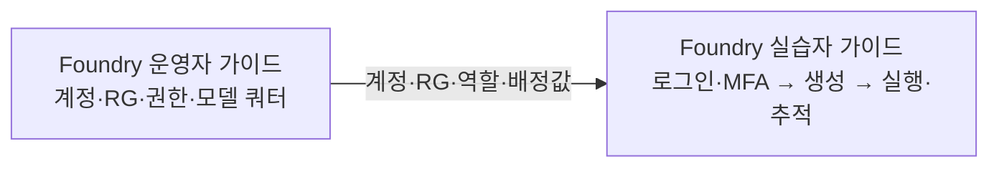

# Microsoft Foundry · Ignite 2026 실습 가이드

Microsoft Ignite 2026의 **Microsoft IQ와 Microsoft Foundry를 설명하는 한글 실습자·운영자 가이드**입니다. Microsoft IQ를 개요의 첫 항목으로 두고, 직접 실행한 범위는 **필수 실습 1~5·선택 실습 6~10**, 미검증 기능은 **소개 카드와 공식 문서**로 안내합니다. 네 IQ와 **Microsoft Copilot SDK 2.0·Voice agents**를 설명하며, 발표 상태와 실제 검증 수준을 구분합니다.

> 운영자가 **계정·리소스 그룹(RG)·권한**을 준비하고, 참가자는 **본인 RG 안에서 Foundry·프로젝트·모델·관측성을 직접 만듭니다.** **실습자 가이드의 모든 화면·영상은 2026.11.18에 North Central US에서 참가자 권한 계정으로 새로 촬영했습니다.** 영문판·PPT는 보류입니다.

Foundry 가이드는 [junwoojeong100/internal-guest-hands-on-guide](https://github.com/junwoojeong100/internal-guest-hands-on-guide) `main`의 `1524c3e`(2026.11.14)에서 가져와 Ignite 2026용으로 확장했습니다. 가져온 뒤의 변경은 Git 이력(첫 커밋 `6e83c5f`)에서 볼 수 있습니다.

## 실습 구성

| 실습 | 내용 | 구분 |
|---|---|---|
| 1 | 로그인·MFA와 내 계정·권한 확인 | 필수 |
| 2 | Foundry 리소스와 프로젝트 만들기 | 필수 |
| 3 | 모델 배포와 가드레일 확인 | 필수 |
| 4 | Prompt Agent 만들고 실행하기 | 필수 |
| 5 | Monitor·Traces로 확인하기 | 필수 |
| 6 | 하네스 에이전트 만들고 실행·관찰하기 | 선택 |
| 7 | Insights로 개선할 문제 찾기 | 선택 |
| 8 | 평가자를 만들고 평가 실행하기 | 선택 |
| 9 | Optimize로 개선안 만들기 | 선택 |
| 10 | Manage로 운영·비용·정책 보기 | 선택 |

## 소개 카드

직접 실행하지 않은 기능은 [`#ignite-learn-more`](index.html#ignite-learn-more)의 소개 카드로 안내합니다. 네 IQ(Foundry·Web·Work·Fabric)와 [Microsoft Copilot SDK 2.0](index.html#learn-copilot-sdk)·[Voice agents](index.html#learn-voice-agents) 등을 개념·구성별 상태·실습하지 않는 이유·공식 문서 링크·확인 수준 배지로 정리했으며, 문서만 확인한 내용을 검증된 실습으로 쓰지 않습니다. **Foundry IQ는 참가자 권한 E2E를 검증하지 못해 실습 대신 소개 카드로 두었습니다**(기능 불가·권한 오류 판정이 아닙니다). Toolboxes·Safety도 후보 점검을 하지 못했으며 기능이 없거나 참가자 권한에서 실패했다고 단정하지 않습니다.

## 가이드

| 나는… | 가이드 | 소스 | 게시 주소 |
|---|---|---|---|
| **참가자(실습자)** | Foundry 실습자 가이드<br>로그인·MFA → 리소스 생성 → 실행·추적 | [`index.html`](index.html) | <https://junwoojeong100.github.io/microsoft-foundry-ignite-2026/> |
| **운영자(SE)** | Foundry 운영자 가이드<br>역할 → 스크립트/포털 → 필수 점검 → 인계·종료 | [`operator.html`](operator.html) | <https://junwoojeong100.github.io/microsoft-foundry-ignite-2026/operator.html> |



두 가이드는 라이트/다크 테마와 **복사 버튼**을 지원합니다. 실습자 가이드는 화면 54장(실습 1~5)·57장(실습 6~10)과 2분 37초 요약 영상·9분 27초 전체 영상(실습 1~5만)을 해당 실습에서 봅니다. CDN·빌드 없이 정적 파일로 열리며, 로컬에서는 다음처럼 확인합니다.

```bash
python3 -m http.server 8000   # http://localhost:8000/index.html · /operator.html
```

## 수정 위치

| 바꾸려는 것 | 고칠 곳 |
|---|---|
| 실습자 본문·문제 대응표·완료 기준 | `index.html` |
| 실습 제목·순서·필수/선택·선행·화면 근거·관련 카드 | `assets/labs-data.js`. 번호는 활성 배열 순서로 계산합니다. 재배치·번호·목차 렌더러는 `assets/labs.js`입니다. |
| 기본 Prompt Agent 절의 제목·설명 | `index.html` 아래쪽 인라인 스크립트의 `stages` |
| 단계별 화면·번호 표시·영상 시점·Instructions·녹화 예시값 | `assets/guide-data.js`. 화면 수가 바뀌면 `index.html`의 `data.shots.length !== 54`도 맞춥니다. |
| New Foundry 본문·소개 카드 | `index.html`의 `id="ignite-*"` 섹션·`id="learn-*"` 카드. 실습 목차는 `labs-data.js`가 정합니다. |
| New Foundry 화면·설명·확인 위치 | `assets/ignite/ignite-data.js`는 생성 파일입니다. 로컬 원본(Git 제외) `internal/tools/rec/`의 `assemble.py publish`가 촬영 결과와 `ignite_specs.json`·`ignite_overrides.json`으로 다시 생성합니다. 화면은 `assets/ignite/screenshots/ko/`(1600×900, 영문 UI + 한국어 입력), 그룹별 자리는 `index.html`의 `data-ignite-gallery="<그룹>"`입니다. 파일 이름·갤러리 순서를 맞추며 생성 JS는 직접 고치지 않습니다. |
| 화면 이미지·영상·자막 | `assets/screenshots/`, `assets/video/` |
| 운영자 본문(역할·준비 절차·점검·인계·종료) | `operator.html` |
| 참가자 Azure 역할·리소스 공급자(RP) 등록 목록 | `scripts/workshop_common.py`의 `ROLES`·`PROVIDERS`, 그리고 두 가이드의 역할 표 |
| 계정·RG 규모·이름·지역 | `config/workshop.example.json`, `scripts/provision_workshop.py`. 예제 설정은 `operator.html`의 JSON 예시·`location` 행과 같아야 하며 테스트가 확인합니다. |
| 로그인·MFA 이미지와 출처 | `assets/onboarding/`, `assets/onboarding/ATTRIBUTION.txt` |
| 기준일·검증 근거 | 두 가이드의 `기준일`과 `assets/verification.json`·`assets/guest-auth-verification.json`. 직접 검증하지 않은 기능으로 검증 범위를 넓혀 쓰지 않습니다. |
| 스타일·동작 | `assets/guide.css`, `theme.js`, `navigation.js`, `copy.js`, `ignite-part2.js`(New Foundry 갤러리, 확대 창은 모든 화면이 공유) |

가이드의 모든 `<pre>`에는 복사 버튼 이름으로 쓰는 `aria-label`이 필요합니다. 이 규칙과 링크·앵커는 아래 [테스트](#테스트)가 확인합니다.

## 운영자 빠른 시작 · Azure 계정·RG·권한 일괄 준비

**Azure Cloud Shell Bash(영구 저장소), Linux/macOS 또는 WSL · Python 3.11+ · Azure CLI**가 필요하며 추가 Python 패키지는 없습니다. 소규모·수동 준비는 [B · 포털 절차](https://junwoojeong100.github.io/microsoft-foundry-ignite-2026/operator.html#portal)를 따르고, 같은 환경에 A/B를 중복 실행하지 않습니다.

```bash
git clone https://github.com/junwoojeong100/microsoft-foundry-ignite-2026.git
cd microsoft-foundry-ignite-2026
cp config/workshop.example.json config/workshop.local.json
# local.json의 tenantId·subscriptionId·고유 workshopId·지역·계정 수를 확인/수정한 뒤 로그인합니다.
az login --tenant "REPLACE_WITH_TENANT_ID"

# 1) 읽기 전용 계획 (기본값: 계정·RG·역할·암호 파일을 만들지 않습니다)
python3 scripts/provision_workshop.py --config config/workshop.local.json

# 2) 검토한 계획을 실제 적용
python3 scripts/provision_workshop.py --config config/workshop.local.json --apply

# 3) 실제 Graph/ARM 상태를 다시 읽어 독립 검증 (실패 시 종료 코드 1)
python3 scripts/verify_workshop.py --config config/workshop.local.json
```

예제 설정(`participantCount=75`, `seTestAccountCount=5`, `nameFormat="user-se"`)은 **고객 `user01`~`user70` + SE 테스트 `se01`~`se05`** 계정, RG `rg-user01`~`rg-user70`·`rg-se01`~`rg-se05`, 직접 RBAC **225개**를 만듭니다. 이름 충돌·재실행·복구·비공개 파일 취급은 [운영자 가이드 A](https://junwoojeong100.github.io/microsoft-foundry-ignite-2026/operator.html#automation)를 따르세요.

## 꼭 지킬 기준

| 주제 | 기준 |
|---|---|
| 참가자 권한 | **본인 RG의 Contributor·Foundry User + 구독의 Cognitive Services Usages Reader**. Entra 관리자 역할은 없습니다. 운영자 Owner 권한은 참가자에게 전달되지 않습니다. |
| 첫 로그인 | 초기 암호 그대로 로그인하며 변경을 강제하지 않습니다(`forceChangePasswordNextSignIn=false`). **MFA 등록·인증은 본인이 완료**하고 MFA·조건부 액세스는 해제하지 않습니다. |
| 인계 전 필수 | **실제 교육망에서 MFA 미등록 테스트 Guest 2개의 첫 로그인·MFA 등록·재로그인**을 확인합니다. 스크립트 PASS나 운영자 계정 성공으로 대신하지 않습니다. |
| 모델·TPM | 일반 실습은 **`gpt-6.1-terra`를 개인별 TPM으로 배분**합니다((70 + 5) × 10,000 = 750,000 TPM은 계산 예시). Optimizer 등 모델 고정 설정은 지정 모델을 유지합니다. |
| 리전 | 참가자 리전은 **North Central US**(`northcentralus`)로 통일합니다(공식 하네스 지원 리전, 2026.11.17 문서 기준). 포털의 Region 기본값은 East US이므로 목록에서 직접 고릅니다. 예제 설정·운영자 JSON·실습자 안내가 어긋나면 테스트가 실패합니다. |
| 관측성 | 본인 RG의 Application Insights를 사용합니다. Foundry 리소스를 만들 때 Application insights를 함께 만들면 프로젝트에 자동 연결되고, Traces에 연결 안내가 보이면 Agent → Traces → **Connect → Create new resource**(대체 경로, 새 Application Insights와 `DefaultWorkspace-*`가 같은 RG에 생성)를 따릅니다. |
| 선택 실습 준비 | 하네스·평가·Optimize·Manage(실습 6~10)는 개인 10,000 TPM으로 부족하고, 평가자 만들기의 Resolve(프로젝트 관리 ID의 Monitoring Reader)는 참가자가 누르면 권한 오류가 나므로 운영자가 할당합니다. 상세는 [운영자 가이드 `#part2-prep`](operator.html#part2-prep)를 따릅니다. |
| 비공개 파일 | `.workshop-runs/<workshopId>/`(초기 암호 포함)는 Git·Pages에서 제외하고 승인된 비공개 저장소에 백업합니다. 참가자 암호는 별도 경로로 개별 전달합니다. |

## 검증 현황

- **확인한 것:** 2026.11.18 North Central US에서 참가자 역할 3개만 가진 새 Internal Guest 계정 1개로 초기 암호 로그인·TOTP MFA 등록·재로그인과 실습 1~10을 처음부터 끝까지 실행하고 화면·영상을 새로 촬영했습니다. 환경은 기존 RG의 리소스를 모두 지운 뒤 새로 만들었습니다(`gpt-6.1-terra` 10,000 TPM으로 필수 실습, 선택 실습은 운영자가 100,000 TPM으로 상향). Manage의 Cost·Compliance·Gateways는 생성·할당 없이 화면만 확인했습니다. 화면·영상은 계정·구독·테넌트 값을 가렸고 OCR로 개인 정보 문자열이 없는지 점검했습니다. [읽기 전용 검증 JSON](assets/verification.json)(ID는 0으로 대체)과 2026.11.08 로그인 검증 [JSON](assets/guest-auth-verification.json)을 제공합니다.
- **아직 확인하지 않은 것:** **AI Gateway 생성·Publish·채널 연결·Optimize 후보 승격·하네스 에이전트의 Optimize 제출·Azure Policy 할당**(2026.11.17에 별도 환경에서만 확인), 운영 구독의 North Central US `gpt-6.1-terra` 쿼터, 10,000 TPM에서의 하네스 재현(2026.11.17 시험은 실패, 이번 재촬영은 100,000 TPM), 비용 데이터가 쌓인 뒤의 Cost 화면(Cost Management Reader 필요 여부), 75개 환경 생성·여러 참가자의 동시 부하, 고객 교육망, Microsoft Authenticator 푸시(촬영 계정은 TOTP로 등록). 개최 전 운영자 가이드의 필수 점검으로 확인하세요.
- **공식 자료:** 기능 이름·상태(Preview/GA)는 2026.11.18에 Ignite 2026 [Book of News](https://news.microsoft.com/events/ignite/2026/book-of-news/)와 공식 블로그·Learn으로 대조했으며(표: [`#ignite-official-check`](index.html#ignite-official-check)), 발표된 모든 변경이 포털에 반영됐다고 단정하지 않습니다. 웹 문서 점검이 Foundry IQ·SDK·Voice 등의 기능 실행 검증을 뜻하지는 않습니다.

## 테스트

Azure에 접속하지 않고 스크립트(가짜 API), 링크·앵커, 화면·영상 파일, New Foundry 화면 데이터(1600×900·확인 위치), 실습 배정·선행·교차 참조·목차 순서, 소개 카드, 예제 설정과 운영자 JSON의 일치, 전환 메뉴·Pages 범위를 검사합니다.

```bash
python3 -m unittest discover -s tests -v
```

## 배포

`main`에 푸시하면 [GitHub Actions 워크플로](.github/workflows/pages.yml)가 위 테스트를 통과한 뒤 HTML·`assets/`(화면·영상)·공개 스크립트·예제 설정만 빌드해 GitHub Pages에 자동 배포합니다. Pages의 배포 원본은 **GitHub Actions**이고 진행 상태는 [Actions](https://github.com/junwoojeong100/microsoft-foundry-ignite-2026/actions/workflows/pages.yml)에서 확인합니다. CI는 Azure 계정·RG·역할을 만들지 않습니다. 화면 출처·재사용 조건은 [ATTRIBUTION](assets/onboarding/ATTRIBUTION.txt)에 있습니다.

- **주소를 바꿀 때:** `operator.html`의 clone·Pages·저장소 주소(인계 템플릿 포함)와 이 README, `tests/test_guides.py`의 `SITE_URL`을 함께 바꿉니다.
- **영상 크기:** `assets/video/*.mp4`는 GitHub 권장 한도 50 MiB·차단 한도 100 MiB 이내로 유지합니다(현재 `full-walkthrough.mp4` 약 8.6 MiB, `summary-walkthrough.mp4` 약 6.8 MiB). 새 영상으로 교체할 때 크기를 확인하세요.
- **예시 식별자:** `assets/guide-data.js`·`assets/verification.json`은 테넌트·구독·개체 ID를 0으로 채우고 계정 표시는 `user@contoso.com` 등으로 바꾼 값입니다(리소스·프로젝트 이름은 촬영 예시). `config/workshop.example.json`과 `operator.html`의 JSON 예시도 두 ID를 0으로 채운 자리표시자이며, 실제 값은 Git에서 제외한 `config/workshop.local.json`에 넣습니다.
