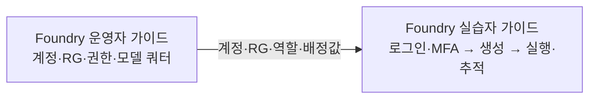

# Microsoft Foundry · Ignite 2026 실습 가이드

Microsoft Ignite 2026의 **Microsoft IQ와 Microsoft Foundry를 설명하는 한글 실습자·운영자 가이드**입니다. Microsoft IQ를 개요의 첫 항목으로 두고, 직접 실행한 범위는 **필수 실습 1~5·선택 실습 6~10**, 미검증 기능은 **소개 카드와 공식 문서**로 안내합니다. Foundry IQ·Web IQ·Work IQ·Fabric IQ를 각각 설명하며, 발표 상태와 실제 검증 수준을 구분합니다.

> 운영자가 **계정·리소스 그룹(RG)·권한**을 준비하고, 참가자는 **본인 RG 안에서 Foundry·프로젝트·모델·관측성을 직접 만듭니다.** 기존 내용·앵커와 구 포털 화면·영상은 보존하고 실습 순서·번호·교차 안내를 재구성했습니다. 영문판·신규 녹화·PPT는 보류입니다.

## 현재 상태 · 가져온 기반

| 항목 | 내용 |
|---|---|
| 원본 | [junwoojeong100/internal-guest-hands-on-guide](https://github.com/junwoojeong100/internal-guest-hands-on-guide) `main`의 `1524c3e`(2026.11.14). [이후 변경 보기](https://github.com/junwoojeong100/internal-guest-hands-on-guide/compare/1524c3e...main) |
| 가져온 것 | Foundry 실습자·운영자 가이드, 공통 자산(CSS·JS·화면 63장·영상 2개·로그인/MFA 이미지·검증 JSON), 운영자 자동화 스크립트와 설정 예제, 오프라인 테스트, Pages 워크플로 |
| 가져오지 않은 것 | GitHub Copilot 실습자·운영자 가이드, Codespaces·Copilot CLI 가이드, 고객 안내 EDM, 그 가이드들의 이미지 |
| 가져오며 바꾼 것 | 가이드 전환 메뉴를 Foundry 2종으로 축소 · GitHub 가이드로 가는 링크·안내·인계 템플릿 줄 제거 · 저장소·Pages 주소를 이 리포로 변경 · 테스트와 워크플로를 2종 기준으로 조정하고 화면·영상 파일 점검 추가 · `ATTRIBUTION.txt`에서 가져오지 않은 이미지 항목 제거 · `.gitignore`에 `.playwright-mcp/` 추가 · README 재작성 |
| 보존한 근거 | 구 포털 화면 63장·영상 2개(2026.11.05, East US 2·GPT-5 mini), 검증 JSON, 프로비저닝 스크립트. 참가자 리전 안내는 North Central US이며 2026.11.17 재현에서 달랐던 Application insights 자동 연결·기본 모델·메뉴는 해당 실습에 별도 메모로 남겼습니다. 옛 화면·영상 자체를 새 포털의 증거로 쓰지 않습니다. |

첫 커밋이 원본 그대로이므로 `git diff <첫 커밋> HEAD`로 가져오며 바꾼 내용을 모두 볼 수 있습니다.

## 실습 구성 · 화면별 근거

| 실습 | 내용 | 구분 |
|---|---|---|
| 1 | 로그인·MFA와 내 계정·권한 확인 | 필수 |
| 2 | Foundry 리소스와 프로젝트 만들기 | 필수 |
| 3 | 모델 배포와 가드레일 확인 | 필수 |
| 4 | Prompt Agent 만들고 실행하기 | 필수 |
| 5 | Monitor·Traces로 확인하기 | 필수 |
| 6 | 하네스 에이전트 만들고 실행·관찰하기 | 선택 |
| 7 | Insights로 개선할 문제 찾기 | 선택 |
| 8 | 평가자를 만들고 평가 실행하기 | 선택 |
| 9 | Optimize로 개선안 만들기 | 선택 |
| 10 | Manage로 운영·비용·정책 보기 | 선택 |

| 항목 | 내용 |
|---|---|
| 위치·흐름 | `index.html`의 Microsoft IQ 개요 → 시작 전 준비·영상 → 실습 1~10 → 문제 대응·완료 기준·참고·소개 카드. Microsoft IQ(`#ignite-microsoft-iq`) 뒤에 로드맵(`#ignite-at-a-glance`)이 나오고, 용어 풀이(`#ignite-glossary`)는 맨 아래 참고 구역에 있습니다. 기존 id·앵커는 유지했습니다. |
| 화면 기준 | 실습 1~5는 2026.11.05 구 포털·East US 2·GPT-5 mini 녹화가 기본입니다. 가드레일과 선택 실습은 2026.11.17 New Foundry·North Central US의 화면이며, 실습 머리글에 각각의 근거·선행 실습을 표시합니다. 단일 시점의 새 포털 화면으로 오해하지 않도록 구분했습니다. |
| New Foundry 화면 | `assets/ignite/screenshots/ko/` 51장(1600×900, 영문 UI + 한국어 입력). 계정·구독·테넌트 값은 가렸고 OCR로 개인 정보 문자열이 없는지 검사했습니다. **선택 실습의 새 동영상은 아직 없습니다.** |
| 데이터·코드 | `assets/labs-data.js`(실습 구성·순서·선행·관련 카드), `assets/labs.js`(재배치·번호·목차), `assets/ignite/ignite-data.js`(화면 설명·확인 위치), `assets/ignite-part2.js`(New Foundry 갤러리). 확대 창은 모든 화면이 공유합니다. |
| 직접 실행 | **① 샌드박스 프로젝트(소유자 권한):** 가드레일 목록, `gpt-6.1-terra` 배포(Global Standard·100,000 TPM), 하네스 에이전트 생성·도구 제한·저장(Version 4)·실행, Insights 스캔, 커스텀 루브릭 평가자, 합성 질문 15개 평가 실행(12행 채점·3행 rate limit 오류). **② 참가자 권한 재현 프로젝트(별도 구독, North Central US, 계정 1개에 RG Contributor + Foundry User + 구독 Usages Reader만 부여):** 필수 실습을 처음부터(Foundry 리소스·프로젝트 생성 → `gpt-6.1-terra` 10,000 TPM 배포 → Prompt Agent → Traces), 하네스 생성·실행(10,000 TPM 실패, 30,000 TPM 단건 통과), Manage의 Fleet·Cost·Operations·Compliance·Quota·Gateways 열기, Insights·커스텀 루브릭 평가자·평가(15행 모두 통과), 하네스 없는 Prompt Agent의 Optimize 실행(후보 승격 안 함), Azure Policy Audit 할당·해제 |
| 화면만 확인 | 샌드박스의 Manage(Fleet·Operations·Cost·Compliance·Gateways), Routines·Workflows, 하네스 에이전트의 Optimize 탭·마법사(제출하지 않음) |
| 하지 않음 | AI Gateway 생성, Publish·채널 연결, Optimize 후보 승격, 하네스 에이전트의 Optimize 제출, 운영 구독의 North Central US `gpt-6.1-terra` 쿼터 확인, 여러 참가자의 동시 실행·부하 |
| 리전 | 참가자 배정 리전은 **North Central US**(`northcentralus`)이며 공식 하네스 지원 리전 22곳에 포함됩니다(2026.11.17 문서 기준). 예제 설정·운영자 JSON·실습자 안내가 어긋나면 테스트가 실패합니다. 구 포털 화면·영상은 '녹화 예시: East US 2'로 보존했습니다. 참가자 계정의 리소스 생성 Region 목록(39개)에 North Central US가 있음을 직접 확인했습니다. |
| 공식 자료 대조 | 2026.11.18에 [Book of News](https://news.microsoft.com/events/ignite/2026/book-of-news/), [Microsoft IQ 블로그](https://azure.microsoft.com/en-us/blog/introducing-the-new-microsoft-iq-putting-your-organizations-intelligence-to-work-in-every-agent/), [Foundry 블로그](https://azure.microsoft.com/en-us/blog/continuous-improvement-comes-to-microsoft-foundry/), [모델 블로그](https://techcommunity.microsoft.com/blog/azure-ai-foundry-blog/from-model-choice-to-your-durable-advantage-build-ai-that-keeps-improving/4573609)와 Learn을 대조했습니다. **Microsoft IQ(GA)**가 개요 첫 항목이며 **네 IQ는 각각 별도 행·소개 카드**입니다. 새 SKU·구독 없음이 하위 기능의 무료·GA를 뜻하지는 않습니다. Foundry IQ는 기존 OTP로 포털 로그인이 중단되어 참가자 권한 E2E를 검증하지 못해 **소개 카드로 확정**했습니다. 나머지 세 IQ도 유료 구독·관리자 동의·Fabric 용량 전제 때문에 소개합니다. Foundry의 지속 개선은 직접 실습합니다. Insights·Agent optimizer·멀티턴 평가는 GA, 주석·golden dataset·루브릭 안전 지원·스킬/비용 최적화·Programmed Training·Cost는 Preview입니다. 포털 Optimize는 하네스 없는 Prompt Agent 대상입니다. 자동 선택은 지원 프로젝트의 기본값이고 프로젝트별 Foundry IQ 리소스(Preview)는 미확인입니다. **발표 뒤 Foundry 기능 화면은 재확인하지 못했으며**, 발표 상태와 직접 확인을 구분합니다. |
| 운영자에게 알릴 점 | 운영자 가이드의 [`#part2-prep`](operator.html#part2-prep) 섹션에 리전·하네스용 TPM·필요 역할·Azure Policy·Optimize·비용·정리를 '공식 문서 기준 / 직접 실행 / 화면만 확인 / 확인하지 못함'으로 나누어 추가했습니다. 재현에서 나온 사전 결정 3가지: **① 평가자 만들기의 Resolve(프로젝트 MI의 Monitoring Reader)는 참가자가 누르면 권한 오류**가 나서 운영자가 할당해야 합니다(명령 예는 `#managed-identity`). **② 10,000 TPM 배포에서는 하네스 질문이 실패**했습니다(30,000 TPM은 천천히 보낼 때만 통과). **③ Compliance의 Asset 탭에 Foundry User 권한 안내**가 떴고 원인은 확인하지 못했습니다. 참가자 필수 역할 3개 표는 바꾸지 않았습니다(3개 역할만으로 화면이 열렸고 Cost 값 표시에 Cost Management Reader가 필요한지만 미확인). |

화면 기준일은 2026.11.17(키노트 전)이고 기능 이름·상태(Preview/GA)는 2026.11.18에 Ignite 2026 Book of News로 다시 대조했습니다. 발표 뒤 포털 화면을 다시 확인하는 일은 남아 있습니다.

## 소개 카드 · 직접 실행하지 않는 기능

[`#ignite-learn-more`](index.html#ignite-learn-more)에 네 IQ의 개념·구성별 상태·Foundry 연결·실습하지 않는 이유·공식 절차 요약·Learn과 발표 링크·확인 수준 배지를 모았습니다. Foundry IQ는 지식 소스 → 지식 베이스 → 에이전트와 출처 확인, Web IQ는 유료 구독·별도 리소스, Work IQ는 전역 관리자 동의·Copilot Credits, Fabric IQ는 라이선스·데이터 에이전트 유료 용량을 구분합니다. 문서만 확인한 내용을 검증된 실습으로 쓰지 않습니다.

**Foundry IQ 실습·샘플 문서·갤러리는 만들지 않았습니다.** 서비스가 불가능하거나 참가자 권한 오류를 확인한 것이 아니라 로그인 단계에서 검증이 멈춘 것입니다. 참가자 권한 검증과 필요한 운영자 준비의 직접 실행이 남아 있습니다.

Tier B 카드 9개는 Business plugins·Hosted agents·에이전트용 Microsoft 365 계정·Toolboxes/브라우저 자동화·Foundry MCP Server·Foundry Safety·Training·새 모델·Azure/Windows 연계를 다룹니다. 각 실습의 '더 알아보기'와 공식 대조표에서 연결합니다. Toolboxes·Safety는 기존 OTP로 포털 로그인이 중단되어 후보 점검을 하지 못했으며, 기능이 없거나 참가자 권한에서 실패했다고 단정하지 않습니다. Cost 실습에는 **추정치와 청구 기준(Azure Cost Management)**을 구분했습니다.

## 가이드

| 나는… | 가이드 | 소스 | 게시 주소 (Pages 배포 후) |
|---|---|---|---|
| **참가자(실습자)** | Foundry 실습자 가이드<br>로그인·MFA → 리소스 생성 → 실행·추적 | [`index.html`](index.html) | <https://junwoojeong100.github.io/microsoft-foundry-ignite-2026/> |
| **운영자(SE)** | Foundry 운영자 가이드<br>역할 → 스크립트/포털 → 필수 점검 → 인계·종료 | [`operator.html`](operator.html) | <https://junwoojeong100.github.io/microsoft-foundry-ignite-2026/operator.html> |



두 가이드는 라이트/다크 테마와 **복사 버튼**을 지원합니다. 구 포털 화면 63장·3분 요약 영상·51분 전체 영상과 New Foundry 화면 51장을 해당 실습에서 봅니다. CDN·빌드 없이 정적 파일로 열리며, 로컬에서는 다음처럼 확인합니다.

```bash
python3 -m http.server 8000   # http://localhost:8000/index.html · /operator.html
```

## Ignite 2026 가이드로 바꿀 때 고칠 곳

| 바꾸려는 것 | 고칠 곳 |
|---|---|
| 실습자 본문·문제 대응표·완료 기준 | `index.html` |
| 실습 제목·순서·필수/선택·선행·화면 근거·관련 카드 | `assets/labs-data.js`. 번호는 활성 배열 순서로 계산합니다. 재배치·번호·목차 렌더러는 `assets/labs.js`입니다. |
| 기본 Prompt Agent 절의 제목·설명 | `index.html` 아래쪽 인라인 스크립트의 `stages` |
| 단계별 화면·번호 표시·영상 시점·Instructions·녹화 예시값 | `assets/guide-data.js`. 화면 수가 바뀌면 `index.html`의 `data.shots.length !== 63`도 맞춥니다. |
| New Foundry 본문·소개 카드 | `index.html`의 `id="ignite-*"` 섹션·`id="learn-*"` 카드. 실습 목차는 `labs-data.js`가 정합니다. |
| New Foundry 화면·설명·확인 위치 | `assets/ignite/ignite-data.js`는 생성 파일입니다. 로컬 원본 `internal/tools/build_ignite_data.py`의 `SHOTS`를 고쳐 다시 생성합니다. 화면은 `assets/ignite/screenshots/ko/`, 그룹별 자리는 `index.html`의 `data-ignite-gallery="<그룹>"`입니다. 파일 이름·갤러리 순서를 맞추며 생성 JS는 직접 고치지 않습니다. |
| 화면 이미지·영상·자막 | `assets/screenshots/`, `assets/video/`. `assets/capture-manifest.json`은 같은 구조의 캡처 기록(다운로드용)이므로 함께 갱신합니다. |
| 운영자 본문(역할·준비 절차·점검·인계·종료) | `operator.html` |
| 참가자 Azure 역할·리소스 공급자(RP) 등록 목록 | `scripts/workshop_common.py`의 `ROLES`·`PROVIDERS`, 그리고 두 가이드의 역할 표 |
| 계정·RG 규모·이름·지역 | `config/workshop.example.json`, `scripts/provision_workshop.py`. 예제 설정은 `operator.html`의 JSON 예시·`location` 행과 같아야 하며 테스트가 확인합니다. |
| 로그인·MFA 이미지와 출처 | `assets/onboarding/`, `assets/onboarding/ATTRIBUTION.txt` |
| 기준일·검증 근거 | 두 가이드의 `기준일`과 `assets/verification.json`·`assets/guest-auth-verification.json`. 새 기능을 직접 검증하기 전에는 원본의 검증 범위를 신규 기능으로 확장해 쓰지 않습니다. |
| 스타일·동작 | `assets/guide.css`, `theme.js`, `navigation.js`, `copy.js` |

가이드의 모든 `<pre>`에는 복사 버튼 이름으로 쓰는 `aria-label`이 필요합니다. 이 규칙과 링크·앵커는 아래 [테스트](#테스트)가 확인합니다.

## 운영자 빠른 시작 · Azure 계정·RG·권한 일괄 준비

**Azure Cloud Shell Bash(영구 저장소), Linux/macOS 또는 WSL · Python 3.11+ · Azure CLI**가 필요하며 추가 Python 패키지는 없습니다. 소규모·수동 준비는 [B · 포털 절차](https://junwoojeong100.github.io/microsoft-foundry-ignite-2026/operator.html#portal)를 따르고, 같은 환경에 A/B를 중복 실행하지 않습니다.

```bash
git clone https://github.com/junwoojeong100/microsoft-foundry-ignite-2026.git
cd microsoft-foundry-ignite-2026
cp config/workshop.example.json config/workshop.local.json
# local.json의 tenantId·subscriptionId·고유 workshopId·지역·계정 수를 확인/수정한 뒤 로그인합니다.
az login --tenant "REPLACE_WITH_TENANT_ID"

# 1) 읽기 전용 계획 (기본값: 계정·RG·역할·암호 파일을 만들지 않습니다)
python3 scripts/provision_workshop.py --config config/workshop.local.json

# 2) 검토한 계획을 실제 적용
python3 scripts/provision_workshop.py --config config/workshop.local.json --apply

# 3) 실제 Graph/ARM 상태를 다시 읽어 독립 검증 (실패 시 종료 코드 1)
python3 scripts/verify_workshop.py --config config/workshop.local.json
```

예제 설정(`participantCount=75`, `seTestAccountCount=5`, `nameFormat="user-se"`)은 **고객 `user01`~`user70` + SE 테스트 `se01`~`se05`** 계정, RG `rg-user01`~`rg-user70`·`rg-se01`~`rg-se05`, 직접 RBAC **225개**를 만듭니다. 이름 충돌·재실행·복구·비공개 파일 취급은 [운영자 가이드 A](https://junwoojeong100.github.io/microsoft-foundry-ignite-2026/operator.html#automation)를 따르세요.

## 꼭 지킬 기준

| 주제 | 기준 |
|---|---|
| 참가자 권한 | **본인 RG의 Contributor·Foundry User + 구독의 Cognitive Services Usages Reader**. Entra 관리자 역할은 없습니다. 운영자 Owner 권한은 참가자에게 전달되지 않습니다. |
| 첫 로그인 | 초기 암호 그대로 로그인하며 변경을 강제하지 않습니다(`forceChangePasswordNextSignIn=false`). **MFA 등록·인증은 본인이 완료**하고 MFA·조건부 액세스는 해제하지 않습니다. |
| 인계 전 필수 | **실제 교육망에서 MFA 미등록 테스트 Guest 2개의 첫 로그인·MFA 등록·재로그인**을 확인합니다. 스크립트 PASS나 운영자 계정 성공으로 대신하지 않습니다. |
| 모델·TPM | 일반 실습은 **`gpt-6.1-terra`를 개인별 TPM으로 배분**합니다((70 + 5) × 10,000 = 750,000 TPM은 계산 예시). Optimizer 등 모델 고정 설정은 지정 모델을 유지합니다. |
| 관측성 | 본인 RG의 Application Insights를 사용합니다. 연결이 없으면 구 포털의 Agent → Traces → **Connect → Create new resource** 경로를 따릅니다. North Central US 재현에서는 리소스 생성 때 자동 연결되어 다시 만들지 않았습니다. |
| 비공개 파일 | `.workshop-runs/<workshopId>/`(초기 암호 포함)는 Git·Pages에서 제외하고 승인된 비공개 저장소에 백업합니다. 참가자 암호는 별도 경로로 개별 전달합니다. |

## 검증 현황

- **확인한 것:** Internal Guest 1명의 기본 Prompt Agent E2E(2026.11.05, GPT-5 mini)와 새 Guest 1개의 초기 암호 + Software OATH(TOTP) MFA 로그인(2026.11.08). [비밀 값 없는 검증 JSON](assets/guest-auth-verification.json)을 제공합니다. New Foundry는 2026.11.17 North Central US의 두 프로젝트(샌드박스, 참가자 역할 3개만 가진 계정 1개의 재현 프로젝트)에서 위 표의 범위만 확인했습니다. 재현에서는 `gpt-6.1-terra`·10,000 TPM으로 필수 실습도 끝까지 실행했습니다(계정 1개).
- **아직 확인하지 않은 것:** **AI Gateway 생성·Publish·채널 연결·Optimize 후보 승격·하네스 에이전트의 Optimize 제출**, 운영 구독의 North Central US `gpt-6.1-terra` 쿼터, 10,000·30,000·100,000 TPM 외의 값에서의 하네스 실행, 비용 데이터가 쌓인 뒤의 Cost 화면(Cost Management Reader 필요 여부), Compliance 정책 평가가 나타나는 조건과 Asset 탭 권한 안내의 원인, 75개 환경 생성·여러 참가자의 동시 부하, 고객 교육망, Microsoft Authenticator 푸시(재현 계정은 TOTP로 등록), Traces의 Create new resource 이후 화면(재현에서는 Application Insights가 자동 생성돼 연결됨). 개최 전 운영자 가이드의 필수 점검으로 확인하세요.

## 테스트

Azure에 접속하지 않고 스크립트(가짜 API), 링크·앵커, 화면·영상 파일, New Foundry 화면 데이터(1600×900·확인 위치), 실습 배정·선행·교차 참조·목차 순서, 소개 카드, 예제 설정과 운영자 JSON의 일치, 전환 메뉴·Pages 범위를 검사합니다.

```bash
python3 -m unittest discover -s tests -v
```

2026.11.18 최종 점검: **오프라인 테스트 50개·외부 링크 75개 통과**. 두 가이드를 데스크톱·태블릿·모바일에서 확인해 오류·가로 넘침·깨진 이미지가 없었고, 10개 실습·13개 카드·기존 앵커·동적 재번호·딥링크·51장 갤러리·확대·테마를 확인했습니다. 최종 데스크톱/모바일 미리보기 8장을 직접 검토하고 OCR 금지 문자열 0건을 확인했습니다. 이는 Foundry IQ 등의 미실행 기능을 검증했다는 뜻이 아닙니다.

## 배포

`main`에 푸시하면 GitHub Actions가 위 테스트를 통과한 뒤 HTML·영상·공개 스크립트·예제 설정만 빌드해 GitHub Pages에 배포합니다. CI는 Azure 계정·RG·역할을 만들지 않습니다. 화면 출처·재사용 조건은 [ATTRIBUTION](assets/onboarding/ATTRIBUTION.txt)에 있습니다.

- **아직 하지 않은 것:** 원격 저장소 생성과 푸시. 만든 뒤 **Settings → Pages → Build and deployment → Source**를 **GitHub Actions**로 설정하면 배포됩니다.
- **주소 가정:** 가이드와 이 문서는 저장소를 `junwoojeong100/microsoft-foundry-ignite-2026`, 게시 주소를 `https://junwoojeong100.github.io/microsoft-foundry-ignite-2026/`로 가정합니다. 이름이나 계정이 다르면 `operator.html`의 clone·Pages·저장소 주소(인계 템플릿 포함)와 이 README를 고치고, `tests/test_guides.py`의 `SITE_URL`도 바꾸면 테스트가 남은 옛 주소를 찾아 줍니다.
- **영상 크기:** `assets/video/full-walkthrough.mp4`는 약 62 MiB로 GitHub의 50 MiB 권장 한도를 넘어 푸시할 때 경고가 나옵니다(100 MiB부터 차단). 새 영상으로 교체할 때 크기를 확인하세요.
- **예시 식별자:** `config/workshop.example.json`, `operator.html`의 JSON 예시, `assets/guide-data.js`, `assets/capture-manifest.json`, `assets/verification.json`에는 원본 E2E에 쓴 테넌트·구독 ID와 계정·리소스 이름이 들어 있습니다. 공개하기 전에 Ignite용 값으로 바꿀지 검토하세요.
