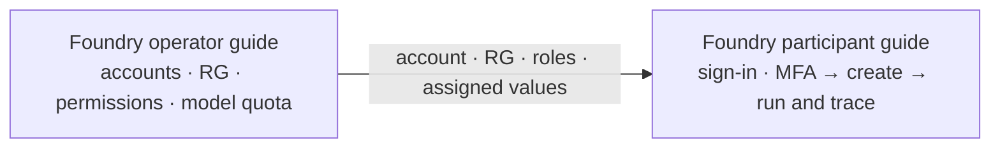

# Microsoft Foundry · Ignite 2026 Lab Guides

**English** · [Korean](README.ko.md)

Participant and operator guides for **Microsoft IQ and Microsoft Foundry** from Microsoft Ignite 2026. Microsoft IQ comes first in the overview. The scope we ran ourselves is **required Labs 1–7 (sign-in → agent → Foundry IQ · Web IQ) and optional Labs 8–16 (Work IQ · Fabric IQ · harness · improvement loop · Hosted agent · Manage · cost)**; features we did not verify are covered by **intro cards and official docs**. Lab 7 (Web IQ, portal-first, no CLI) was run directly in the Azure portal, the Web IQ portal and the Foundry portal with a participant account, and Lab 8 (Work IQ) and Lab 9 (Fabric IQ) were run directly on 2026-11-22 with Member test accounts (Lab 9 on an F2 capacity created in Azure), while the **reference guides** (connecting Work IQ and Fabric IQ, getting started with the Microsoft Copilot harness and SDK 2.0, and GitHub Copilot updates) summarize official docs and were not run in full. Renamed items such as Foundry IQ (formerly Azure AI Search), Microsoft Copilot SDK (formerly GitHub Copilot SDK) and the Microsoft Copilot harness (evolved from the GitHub Copilot harness) are collected in [renamed items at a glance](index.en.html#ignite-renamed). The guides also explain Work IQ, Fabric IQ and **the layers of Microsoft Copilot SDK 2.0, Voice agents and cost management**, and they keep announced status apart from the level we actually verified.

> The operator prepares **accounts, resource groups (RG) and permissions**, and each participant **creates Foundry, the project, the model and observability inside their own RG.** **All screens and videos in the participant guide were captured on 2026-11-18 in North Central US with a participant-permission account.** The **English edition** (`index.en.html` · `operator.en.html`) is a translation with the same structure. **The screens and video segments that showed Korean were re-captured with English inputs on 2026-11-19 (KST; the evening of 2026-11-18 in UTC).** The PPT is on hold.

The Foundry guide was imported from [junwoojeong100/internal-guest-hands-on-guide](https://github.com/junwoojeong100/internal-guest-hands-on-guide) `main` at `1524c3e` (2026-11-14) and extended for Ignite 2026. The changes made after the import are in the Git history (first commit `8ebc58b`).

## Lab structure

| Lab | Content | Type |
|---|---|---|
| 1 | Sign in, MFA, and check your account and permissions | Required |
| 2 | Create the Foundry resource and project | Required |
| 3 | Deploy a model and check guardrails | Required |
| 4 | Create and run a Prompt Agent | Required |
| 5 | Check with Monitor and Traces | Required |
| 6 | Connect knowledge to an agent with Foundry IQ (operator prep required) | Required |
| 7 | Connect current web information with Web IQ (portal only, no CLI · run directly; operator prep required) | Required |
| 8 | Connect Microsoft 365 work context to an agent with Work IQ (run directly on 2026-11-22 with a Member test account, 17 screens; tenant administrator and operator prep required) | Optional |
| 9 | Connect Fabric data to an agent with Fabric IQ, using the portals (run directly on 2026-11-22 in Azure and Fabric, 23 screens; Fabric license, capacity and operator prep required) | Optional |
| 10 | Create, run and observe a harness agent | Optional |
| 11 | Find problems to improve with Insights | Optional |
| 12 | Create an evaluator and run an evaluation | Optional |
| 13 | Create improvement candidates with Optimize | Optional |
| 14 | Call and observe a Hosted agent (the operator deploys it in advance) | Optional |
| 15 | See operations, cost and policy in Manage | Optional |
| 16 | See costs and create a token budget (Cost Control) | Optional |

## Intro cards

Features we did not run ourselves are covered by the intro cards at [`#ignite-learn-more`](index.en.html#ignite-learn-more). Work IQ, Fabric IQ, [Microsoft Copilot SDK 2.0](index.en.html#learn-copilot-sdk), [Voice agents](index.en.html#learn-voice-agents), [cost management](index.en.html#learn-cost-management) and more are laid out with the concept, the status per configuration, why we did not run a lab, links to the official docs and a verification-level badge. Content that we only checked in documents is never presented as a verified lab. **Foundry IQ, Web IQ, Work IQ, Fabric IQ and Hosted agents are concept cards tied to labs.** Lab 7 is the Web IQ lab: its Web IQ resource, portal and tool-connection steps and its comparison with the built-in Foundry Web search tool were all run directly, which the card's badge states. Lab 8 (Work IQ) and Lab 9 (Fabric IQ) were also run directly (with Member test accounts on 2026-11-22), and their labels and cards say so and point to each other. How the names Microsoft Copilot harness, GitHub Copilot SDK and Microsoft Copilot SDK relate is explained in [Names explained](index.en.html#ignite-harness-names). We could not complete the candidate review for Toolboxes and Safety, and we do not claim that the features do not exist or that they fail with participant permissions. The connection methods for Work IQ and Fabric IQ, getting started with the Microsoft Copilot harness and SDK 2.0, and the GitHub Copilot updates at Ignite 2026 are collected in the [reference guides](index.en.html#ignite-reference-guides).

## Guides

| I am a… | Guide | Source | Published URL |
|---|---|---|---|
| **Participant** | Foundry participant guide<br>Sign-in and MFA → create resources → run and trace | [`index.en.html`](index.en.html) · Korean [`index.html`](index.html) | <https://junwoojeong100.github.io/microsoft-foundry-ignite-2026/index.en.html> · Korean <https://junwoojeong100.github.io/microsoft-foundry-ignite-2026/> |
| **Operator (SE)** | Foundry operator guide<br>Roles → scripts/portal → required checks → handoff and wrap-up | [`operator.en.html`](operator.en.html) · Korean [`operator.html`](operator.html) | <https://junwoojeong100.github.io/microsoft-foundry-ignite-2026/operator.en.html> · Korean <https://junwoojeong100.github.io/microsoft-foundry-ignite-2026/operator.html> |



Both guides support light and dark themes and **copy buttons**. The participant guide shows 54 screens (Labs 1–5), 159 screens (guardrails and Labs 6–16, including 21 for Web IQ, 17 for Work IQ and 23 for Fabric IQ), a 2 min 38 s summary video and a 9 min 38 s full video (both Labs 1–5), plus one video each for Labs 6–9 and for the optional Labs 10–16 (recorded 2026-11-22, chapters, captions, silent, loaded only when played) in the matching labs. The pages open as static files with no CDN or build step. To check them locally:

```bash
python3 -m http.server 8000   # http://localhost:8000/index.en.html · /operator.en.html (Korean: /index.html · /operator.html)
```

## Where to change things

| What you want to change | Where |
|---|---|
| Participant body text, troubleshooting table, completion criteria | `index.html` (Korean) · `index.en.html` (English) |
| Lab titles, order, required/optional, prerequisites, screen evidence, related cards | `assets/labs-data.js` (Korean) · `assets/labs-data.en.js` (English). Numbers are computed from the order of the active array. The renderer for reordering, numbers and the table of contents is `assets/labs.js`. |
| Title and description of the basic Prompt Agent section | `stages` in the inline script at the bottom of `index.html` · `index.en.html` |
| Per-step screens, numbering, video times, Instructions, recording example values | `assets/guide-data.js` · `assets/guide-data.en.js`. If the number of screens changes, update `data.shots.length !== 54` in the page, too. |
| New Foundry body text and intro cards | `id="ignite-*"` sections and `id="learn-*"` cards in `index.html` · `index.en.html`. The lab table of contents is decided by `labs-data.js`. |
| New Foundry screens, descriptions, highlights | `assets/ignite/ignite-data.js` · `assets/ignite/ignite-data.en.js` are generated files. The local source (excluded from Git) `internal/tools/rec/` regenerates them with `assemble.py publish` from the capture results, `ignite_specs.json` and `ignite_overrides.json`. Screens are in `assets/ignite/screenshots/ko/` (1600×900, English UI with Korean inputs) and `assets/ignite/screenshots/en/` (English inputs). The place of each group is `data-ignite-gallery="<group>"` in the page. Keep file names and gallery order aligned, and do not edit the generated JS by hand. |
| Screenshots, videos, captions | `assets/screenshots/`, `assets/video/` |
| Videos of Labs 6–9 and 10–16 (player, chapters, captions) | `assets/lab-video.js` renders a player into every `data-lab-video` panel (`video-iq`, `video-optional`) and handles the `data-lab-video-jump` watch links in the labs. The panel text is in the pages; the chapters, poster, duration and caption cues are in `assets/ignite/video-data.js` · `assets/ignite/video-data.en.js`, which are generated files. The local helper (excluded from Git) `internal/tools/publish_lab_videos.py` copies `assets/video/iq-walkthrough[.en].mp4`, `optional-walkthrough[.en].mp4` and `captions-<group>.<ko\|en>.vtt` from the `internal/tools/rec/out-v2/` build output and regenerates the data (`--stub` writes placeholders, listed in `assets/video/.stub-files`; the Pages workflow refuses to publish while that file exists). Do not edit the generated JS by hand. |
| Operator body text (roles, preparation steps, checks, handoff, wrap-up) | `operator.html` · `operator.en.html` |
| Participant accounts and permissions (roles) | `ROLES` (3 by default), `IQ_ROLES` (2 RG-scope roles for Foundry IQ, when `foundryIq` in the config is `true`) and `PROVIDERS` in `scripts/workshop_common.py`, plus the role tables in both guides |
| Hosted agent sample and deployment script | `assets/hosted-agent-sample/` (sample source) and `scripts/deploy_hosted_agent.sh` (REST deploy, invoke, delete). The operator procedure is `operator.html#hosted-prep` |
| Foundry IQ lab documents | `assets/foundry-iq-sample/*.md` (3 fictional documents, Korean) and `assets/foundry-iq-sample/en/*.md` (English). The download links in Lab 6 and the tests check them. |
| Account and RG count, names, region | `config/workshop.example.json`, `scripts/provision_workshop.py`. The example config must match the JSON example and the `location` row in `operator.html`, and a test checks this. |
| Sign-in and MFA images and their sources | `assets/onboarding/`, `assets/onboarding/ATTRIBUTION.txt` (English: `ATTRIBUTION.en.txt`) |
| As-of date and verification evidence | The as-of date in both guides, and `assets/verification.json` · `assets/guest-auth-verification.json` (English: `assets/verification.en.json`). Do not extend the verification scope to features we did not verify ourselves. |
| Style and behavior | `assets/guide.css`, `theme.js`, `navigation.js`, `copy.js`, `ignite-part2.js` (New Foundry gallery; the enlarge window is shared by all screens) |
| English edition | `index.en.html` and `operator.en.html` are translations with the same structure as the Korean pages (ids, links, table rows, gallery groups); the tests check structural parity and zero Hangul. Data: `assets/guide-data.en.js`, `labs-data.en.js`, `ignite/ignite-data.en.js`, `ignite/video-data.en.js`. Shared on-screen strings: `assets/i18n.js` (the language follows `<html lang>`). Videos and captions: `assets/video/*.en.mp4`, `captions.en.vtt` and `captions-*.en.vtt`. **Only the screens re-captured with English inputs** are in `assets/screenshots/en/` (26 of 54) and `assets/ignite/screenshots/en/` (29 of 98, plus 1 placeholder); every other screen points to the Korean edition's file. Objects created for the English captures carry an `-en` suffix (for example `workshop-assistant-en`). |

Every `<pre>` in the guides needs an `aria-label`, which is used as the name of the copy button. The [tests](#tests) below check this rule and the links and anchors.

## Operator quick start · prepare Azure accounts, RGs and permissions in bulk

You need **Azure Cloud Shell Bash (persistent storage), Linux/macOS or WSL · Python 3.11+ · Azure CLI**; there are no extra Python packages. For a small or manual setup, follow [B · portal procedure](https://junwoojeong100.github.io/microsoft-foundry-ignite-2026/operator.en.html#portal), and do not run A and B in the same environment.

```bash
git clone https://github.com/junwoojeong100/microsoft-foundry-ignite-2026.git
cd microsoft-foundry-ignite-2026
cp config/workshop.example.json config/workshop.local.json
# Check and edit tenantId, subscriptionId, a unique workshopId, region and account counts in local.json, then sign in.
az login --tenant "REPLACE_WITH_TENANT_ID"

# 1) Read-only plan (default: creates no accounts, RGs, roles or password files)
python3 scripts/provision_workshop.py --config config/workshop.local.json

# 2) Apply the plan you reviewed
python3 scripts/provision_workshop.py --config config/workshop.local.json --apply

# 3) Read the real Graph/ARM state again and verify independently (exit code 1 on failure)
python3 scripts/verify_workshop.py --config config/workshop.local.json
```

The example config (`participantCount=75`, `seTestAccountCount=5`, `nameFormat="user-se"`, `foundryIq=true`) creates the accounts **customers `user01`–`user70` + SE test `se01`–`se05`**, the RGs `rg-user01`–`rg-user70` and `rg-se01`–`rg-se05`, and **375** direct RBAC assignments (per account: Contributor, Foundry User, Search Service Contributor and Search Index Data Contributor on its own RG, and Cognitive Services Usages Reader on the subscription; 225 if `foundryIq=false`). The search service and managed-identity roles for Foundry IQ (Lab 6) are prepared with the commands in [operator guide: preparation for required Labs 6 and 7](https://junwoojeong100.github.io/microsoft-foundry-ignite-2026/operator.en.html#iq-prep), not by the script. For name conflicts, reruns, recovery and handling of private files, follow [operator guide A](https://junwoojeong100.github.io/microsoft-foundry-ignite-2026/operator.en.html#automation).

## Rules to keep

| Topic | Rule |
|---|---|
| Participant permissions | **Contributor and Foundry User on their own RG + Cognitive Services Usages Reader on the subscription** (if you run Foundry IQ Lab 6, add Search Service Contributor and Search Index Data Contributor on their own RG). They have no Entra admin role. The operator's Owner permission is not passed on to participants. |
| First sign-in | They sign in with the initial password and are not forced to change it (`forceChangePasswordNextSignIn=false`). **They complete MFA registration and verification themselves**, and MFA and Conditional Access are never turned off. |
| Before handoff | Confirm **first sign-in, MFA registration and re-sign-in of 2 test Guests without MFA, on the real training network**. A script PASS or a success with an operator account does not replace it. |
| Model · TPM | General labs **split `gpt-6.1-terra` as a per-person TPM** ((70 + 5) × 10,000 = 750,000 TPM is a calculation example). Settings that fix a model, such as the optimizer, keep the specified model. |
| Region | The participant region is unified to **North Central US** (`northcentralus`) (an official harness-supported region, per the docs of 2026-11-17). The portal's Region default is East US, so pick it from the list. If the example config, the operator JSON and the participant instructions disagree, a test fails. |
| Observability | They use Application Insights in their own RG. If Application insights is created together with the Foundry resource, it is connected to the project automatically. If Traces shows a connect prompt, follow Agent → Traces → **Connect → Create new resource** (alternate path; a new Application Insights and `DefaultWorkspace-*` are created in the same RG). |
| Preparation for required Labs 6 and 7 | **Foundry IQ (Lab 6)** needs one serverless Azure AI Search service per RG, the search service managed identity's Cognitive Services User, and the project managed identity's Search Index Data Reader (after the project exists); also check the embedding model quota (Standard ada-002 is 350K TPM in this subscription and region). **Web IQ (Lab 7)** needs a paid Azure subscription, the `Microsoft.WebIQ` provider registered on the subscription and terms and billing approval; its steps (resource, Web IQ portal, Foundry tool connection) were run directly with a participant account on one subscription, so rehearse them on your own subscription. A participant cannot delete the resource in the portal, so the operator deletes it, and participants who cannot create the resource use the built-in Web search in Lab 7-5. For details, follow [operator guide `#iq-prep`](operator.en.html#iq-prep). |
| Preparation for optional labs | The harness, evaluation, Optimize and Manage labs (Labs 10–15) need more than the individual 10,000 TPM, and Resolve in evaluator creation (Monitoring Reader for the project managed identity) gives a permission error when a participant selects it, so the operator assigns it. For Hosted agent (Lab 14), the operator deploys the source ZIP per project. For Work IQ (Lab 8, run directly on 2026-11-22), a global administrator sets up the tenant once, the licenses are decided, test mail and meetings go into the asking user's mailbox, and the Work IQ MCP connection is created in each project; see [operator guide `#work-iq-prep`](operator.en.html#work-iq-prep). For Fabric IQ (Lab 9, run directly on 2026-11-22), a Fabric license, a paid F2 or higher capacity, Fabric tenant settings and a published Fabric item are needed, and the connection of the Fabric IQ (OneLake Catalog) tool (`fabric_iq_preview`) is created in each project (pause or delete the capacity after the lab); see [operator guide `#fabric-iq-prep`](operator.en.html#fabric-iq-prep). For details, follow [operator guide `#part2-prep`](operator.en.html#part2-prep). |
| Private files | Keep `.workshop-runs/<workshopId>/` (it holds initial passwords) out of Git and Pages, and back it up to an approved private repository. Hand participant passwords over individually through a separate channel. |

## Verification status

- **What we checked:** On 2026-11-18 in North Central US, with 1 new Internal Guest account that has only the 3 participant roles, we ran the initial-password sign-in, TOTP MFA registration, re-sign-in and Labs 1–16 except Labs 8 and 9 (Work IQ and Fabric IQ, which we ran separately with Member test accounts) from start to finish, and captured the screens again (the summary and full videos cover Labs 1–5; Labs 6–9 and 10–16 each have a video recorded on 2026-11-22 in a separate run, so its results can differ from the screens). For Lab 6 (Foundry IQ) the operator had prepared the search service and roles, and for Lab 14 (Hosted agent) the operator had prepared the agent. We deleted all resources in the existing RG and created them again (required Labs 1–5 on `gpt-6.1-terra` at 10,000 TPM; for later labs the operator raised it to 100,000 TPM). In Manage, Cost, Compliance and Gateways were viewed on screen only, with nothing created or assigned. Account, subscription and tenant values are hidden in the screens and videos, and OCR checked that no personal strings remain. We provide a [read-only verification JSON](assets/verification.json) (IDs replaced with zeros; English: [`verification.en.json`](assets/verification.en.json)) and the 2026-11-08 sign-in verification [JSON](assets/guest-auth-verification.json). **For the English edition**, the screens and video segments that showed Korean were captured again with English inputs in the same project and with the same participant account, using new objects with an `-en` suffix and nothing deleted; the other screens are reused from the original capture. One screen (Lab 12, the Setup incomplete / Resolve warning) could not be reproduced because the Monitoring Reader role was already granted, so the English edition shows a placeholder there ("English screenshot in preparation") and the step text describes the warning. **Lab 7 (Web IQ)** was run again on 2026-11-21 in the Azure portal, the Web IQ portal and the Foundry portal with the same participant account: after the operator registered the `Microsoft.WebIQ` provider, the participant created the Web IQ resource, got HTTP 200 in the Playground, connected the Web IQ tool in Foundry's Catalog, asked the question and saw `execute_tool mcp_WebIQ.web` in Traces. We captured 21 screens for it (9 of them again with English inputs for the English edition). The participant could not delete the resource in the portal, so the operator deleted it with the CLI. **Labs 8 and 9 (Work IQ and Fabric IQ)** were run on 2026-11-22 in New Foundry and the Fabric portal. We created Member test accounts with a Microsoft 365 E7 license and the 3 participant roles, set up the Work IQ service principal, app registration, consent and test mail and meetings with Microsoft Graph, and created an F2 Fabric capacity, a workspace, a sample lakehouse (28 tables) and a data agent. Lab 8 covers the connection, first sign-in and consent, approval, 3 questions, the permission boundary (an email only in the operator's mailbox) and Traces (17 screens, 11 again with English inputs), and Lab 9 has four steps: creating, publishing and sharing the data agent in the Fabric portal, the connection with the Fabric IQ (OneLake Catalog) tool, attaching the tool to an agent, and 3 questions with the missing answer and the Failed trace for an account without permission, and Traces (23 screens, 9 again with English inputs). Key findings: Internal Guest participant accounts (no license, no mailbox) get empty Work IQ results; Work IQ handles times in UTC; the OneLake Catalog list looks empty until you clear its default Semantic model filter; an account without Fabric permissions gets no answer and a Failed trace with `tool_user_error`; and the same Fabric question can return different numbers from run to run.
- **What we have not checked yet:** **Lab 8 (Work IQ): the Entra portal screens (we ran the administrator setup with Graph), a tenant with Copilot Credits billing turned on, the permission test with a SharePoint document and licensed external (Guest) users**, **Lab 9 (Fabric IQ): ontologies, Power BI semantic models, custom OAuth apps, Fabric license differences, granting permission on only one of the data agent and the lakehouse, and the behavior with tool-call approval turned on**, **The reference guides (connecting Work IQ and Fabric IQ, getting started with the Copilot SDK, and GitHub Copilot updates) except the parts that Labs 8 and 9 ran**, **Simultaneous use by several participants and the 70-person scale** (the serverless Search service count limit and embedding quota for Foundry IQ, bulk deployment of Hosted agents per project, and whether every participant gets their own Web IQ AppID), **Cost Control's Send alert, Block usage and dollar budget**, **AI Gateway creation, Publish, channel connection, promoting an Optimize candidate, submitting a harness agent to Optimize and assigning Azure Policy** (checked only in a separate environment on 2026-11-17), Web IQ on other subscription types (we used one internal subscription), the Custom MCP connection path, Entra ID authentication, Scopes, BYOL, Commerce and Auto of Web IQ, Web IQ call charges in Cost analysis, why traces from questions sent by a script-launched fresh browser never arrived, SharePoint knowledge sources and knowledge graphs, the `gpt-6.1-terra` quota in North Central US in the production subscription, reproducing the harness at 10,000 TPM (the 2026-11-17 test failed; this re-capture used 100,000 TPM), the Cost screen after cost data has accumulated (whether Cost Management Reader is needed), the customer training network, and Microsoft Authenticator push (the capture account was registered with TOTP). Confirm these with the operator guide's required checks before the event.
- **Official sources:** Feature names and status (Preview/GA) were checked on 2026-11-18 against the Ignite 2026 [Book of News](https://news.microsoft.com/events/ignite/2026/book-of-news/), official blogs and Learn (table: [`#ignite-official-check`](index.en.html#ignite-official-check)), and we do not claim that every announced change is already in the portal. Checking web documents does not mean we ran or verified features such as Foundry IQ, the SDKs or Voice.

## Tests

Without connecting to Azure, the tests check the scripts (against a fake API), links and anchors, screen and video files, the Labs 6–16 video data (chapters that point at guide steps, captions, durations, sizes), New Foundry screen data (1600×900 and highlights), lab assignment, prerequisites, cross references and table-of-contents order, intro cards, agreement between the example config and the operator JSON, the switch menu and Pages scope, and **structural parity of the Korean and English pages, the language-switch links, zero Hangul in the English files and the English video length**.

```bash
python3 -m unittest discover -s tests -v
```

## Deployment

Pushing to `main` runs the [GitHub Actions workflow](.github/workflows/pages.yml). After the tests above pass, it builds only the HTML, `assets/` (screens and videos), public scripts and the example config, and deploys them to GitHub Pages. The Pages source is **GitHub Actions**, and you can follow progress in [Actions](https://github.com/junwoojeong100/microsoft-foundry-ignite-2026/actions/workflows/pages.yml). CI does not create Azure accounts, RGs or roles. The sources and reuse conditions of the screens are in [ATTRIBUTION](assets/onboarding/ATTRIBUTION.en.txt).

- **When you change the address:** change the clone, Pages and repository addresses in `operator.html` and `operator.en.html` (including the handoff template), this README, and `SITE_URL` in `tests/test_guides.py` together.
- **Video size:** keep `assets/video/*.mp4` within GitHub's recommended 50 MiB and blocked 100 MiB limits (currently about 8.7 MiB for `full-walkthrough.en.mp4` and 6.7 MiB for `summary-walkthrough.en.mp4`; the Korean `full-walkthrough.mp4` is about 8.6 MiB and `summary-walkthrough.mp4` about 6.8 MiB). Each of the four Labs 6–16 videos (`iq-walkthrough*.mp4`, `optional-walkthrough*.mp4`) must stay under 50 MiB, and a test checks that. Check the size when you replace a video.
- **Example identifiers:** `assets/guide-data.js` (and the English `guide-data.en.js`) and `assets/verification.json` have tenant, subscription and object IDs filled with zeros and account displays replaced with `user@contoso.com` and similar (resource and project names are capture examples). The JSON example in `config/workshop.example.json` and `operator.html` also uses zero-filled placeholders for the two IDs; put the real values in `config/workshop.local.json`, which is excluded from Git.
